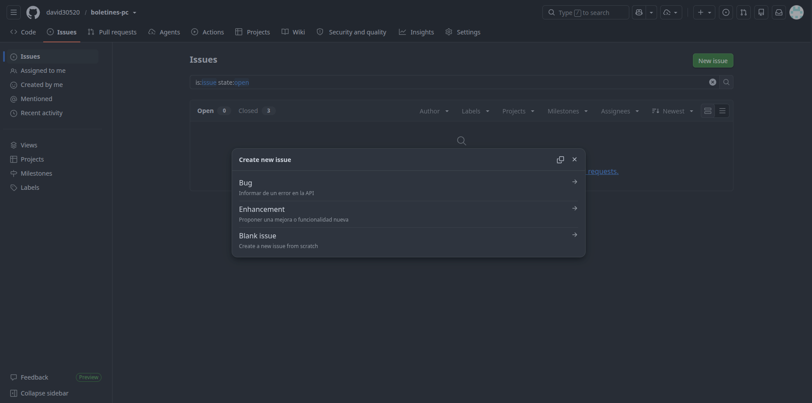
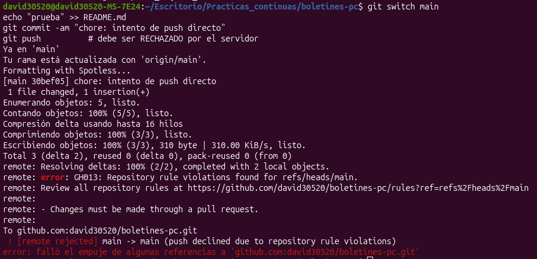
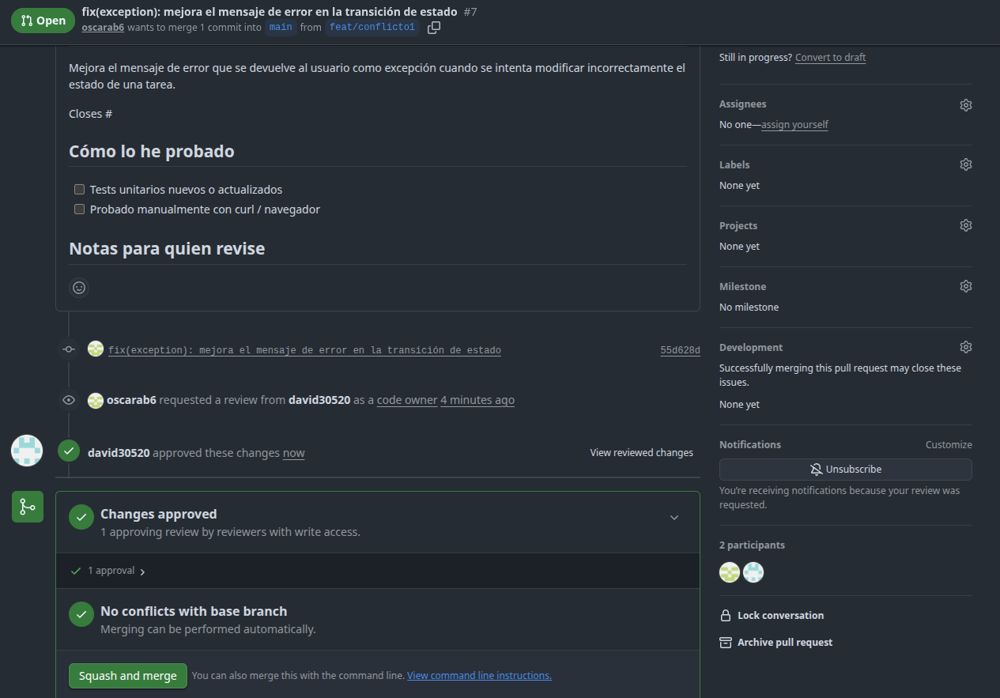
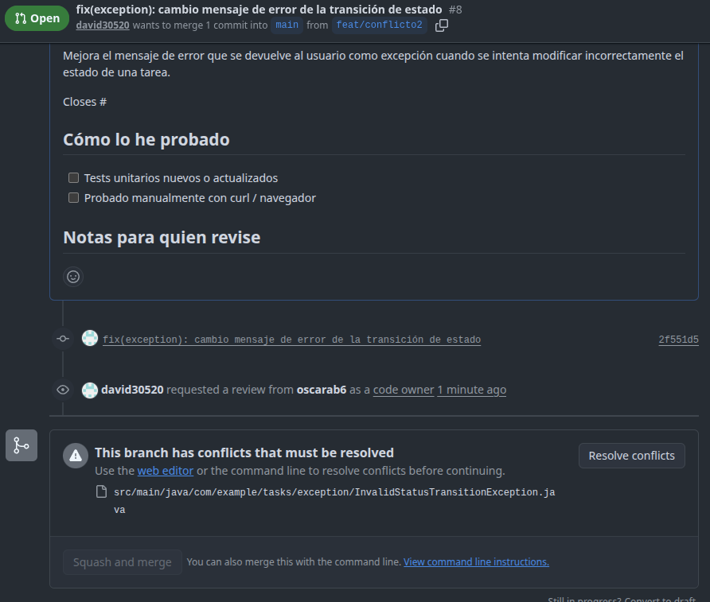
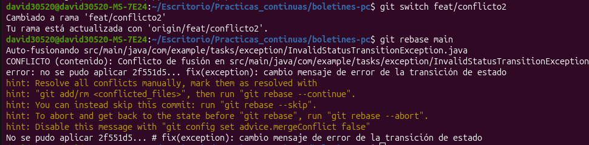
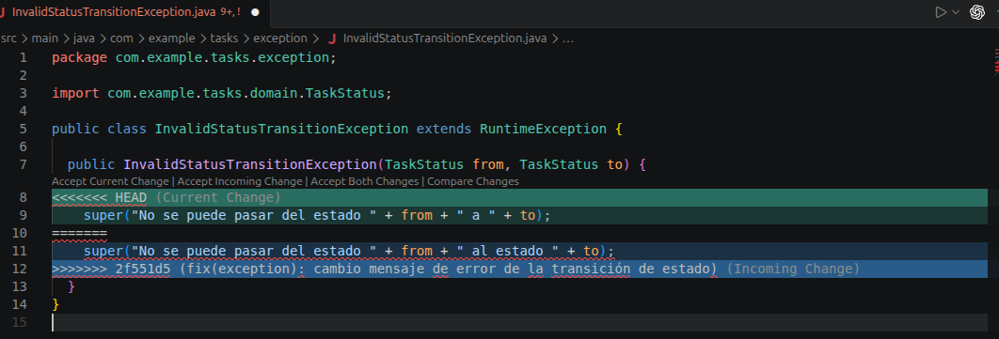
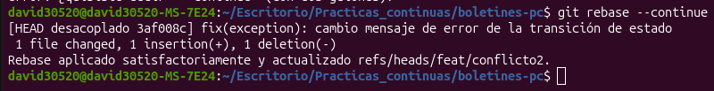
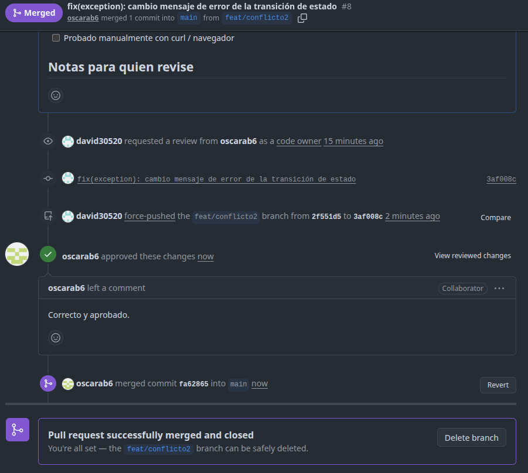
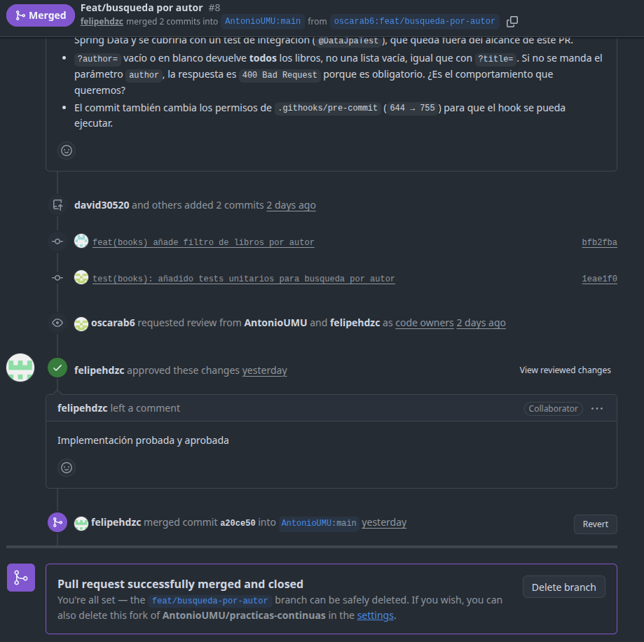

# Boletín 2

## Resumen de commits

| #   | Mensaje del commit                                                      | Qué se hizo                                                                                   | Autor                       | Enlace                                                                                                       |
| --- | ----------------------------------------------------------------------- | --------------------------------------------------------------------------------------------- | --------------------------- | ------------------------------------------------------------------------------------------------------------ |
| 1   | `chore(github): añade propietarios del código`                          | Se añadió el fichero `.github/CODEOWNERS.md`                                                  | David Abellán Bleda         | [787907f](https://github.com/david30520/boletines-pc/commit/787907fe441f5a741f43bf1ade9a0eeaeefb025c)        |
| 2   | `docs(contributing): añade guía de contribución al repositorio`         | Se añadió el fichero `CONTRIBUTING.md`                                                        | David Abellán Bleda         | [32a3101](https://github.com/david30520/boletines-pc/commit/32a3101d39028536439c996ef86170058fa6f2e4)        |
| 3   | `chore: añade plantillas de PR e Issues`                                | Se añadieron las plantillas para colaborar                                                    | Óscar Abellán Bleda         | [cb57ae0](https://github.com/david30520/boletines-pc/commit/cb57ae0284cba79a8a1e8c32a2258d44cd59560a)        |
| 4   | `feat(tasks): añade filtrado de tareas por prioridad`                   | PR externa que añade nueva funcionalidad de filtrado                                          | felipehdzc y AntonioUMU     | [ca02655](https://github.com/david30520/boletines-pc/commit/ca026551e9f791f9f82cd9135c90308506932580)        |
| 5   | `feat(tasks): añade paginación al listado de tareas`                    | PR que añade nueva funcionalidad de paginación                                                | David Abellán Bleda         | [b0176aa](https://github.com/david30520/boletines-pc/commit/b0176aa44a7b204e4074234570920794df528c94)        |
| 6   | `feat(tasks): añade flujo de estados y endpoint PATCH de estado`        | PR que añade nueva funcionalidad para actualizar tareas                                       | Óscar Abellán Bleda         | [b11d492](https://github.com/david30520/boletines-pc/commit/b11d49210d517d2350a5f7ed1e6ce380fe4f365f)        |
| 7   | `fix(exception): mejora el mensaje de error en la transición de estado` | PR para generar el conflicto del apartado E                                                   | Óscar Abellán Bleda         | [99aeab1](https://github.com/david30520/boletines-pc/commit/99aeab1868407790adba70b40f5b4de63a28adf7)        |
| 8   | `fix(exception): cambio mensaje de error de la transición de estado`    | PR para generar el conflicto del apartado E y solucionarlo                                    | David Abellán Bleda         | [fa62865](https://github.com/david30520/boletines-pc/commit/fa6286571c15365d827e2a0b55f3b8c5825021c3)        |
| 9   | `feat(books) añade filtro de libros por autor`                          | se añadió funcionalidad de filtro de libros al repositorio de la otra pareja                  | David Abellán Bleda         | [bfb2fba](https://github.com/AntonioUMU/practicas-continuas/commit/bfb2fbaf2a9caaeddb477f2a5ff523b638f89f38) |
| 10  | `test(books): añadido tests unitarios para busqueda por autor`          | se añadieron test para la funcionalidad de filtro de libros del repositorio de la otra pareja | Óscar Abellán Bleda         | [1eae1f0](https://github.com/AntonioUMU/practicas-continuas/commit/1eae1f0bb3ef4ef69234b2535e976a3775265e4e) |
| 11  | `Merge pull request #8 from oscarab6/feat/busqueda-por-autor`           | merge commit del PR hacia la otra pareja                                                      | Óscar y David Abellán Bleda | [a20ce50](https://github.com/AntonioUMU/practicas-continuas/commit/a20ce505c2f8acc21f1d79608b262856f2ce4277) |

## Detalle por commit

### 1. `chore(github): añade propietarios del código`

- **Qué se hizo:** se añadió el fichero .github/CODEOWNERS.md para definir los propietarios del código del repositorio.
- **Autor:** David Abellán Bleda.
- **Relación con el boletín:** apartado B.
- **Uso de IA:** no se ha usado.

### 2. `docs(contributing): añade guía de contribución al repositorio`

- **Qué se hizo:** se añadió el fichero CONTRIBUTING.md con los pasos para contribuir al repositorio.
- **Autor:** David Abellán Bleda.
- **Relación con el boletín:** apartado B.
- **Uso de IA:** se ha usado ChatGPT con el prompt:
  ```text
  Genera el archivo CONTRIBUTING.md con todas las instrucciones claras para contribuir al proyecto, para ello ayudate del fichero README.md
  ```

### 3. `chore: añade plantillas de PR e Issues`

- **Qué se hizo:** se añadieron las plantillas para PR e Issues al repositorio para facilitar la colaboración.
- **Autor:** Óscar Abellán Bleda.
- **Relación con el boletín:** apartado B.
- **Uso de IA:** se ha usado Claude con el prompt: generame las plantillas de Issue .github/ISSUE_TEMPLATE/enhancement.md y .github/ISSUE_TEMPLATE/bug.md para que todo el mundo que contribuya al repositorio tenga dichas plantillas como base.

### 4. `feat(tasks): añade filtrado de tareas por prioridad`

- **Qué se hizo:** PR "externo" donde se introduce nueva funcionalidad a la API, que consiste en filtrar mediante un endpoint, tareas por su campo prioridad.
- **Autor:** felipehdzc y AntonioUMU
- **Relación con el boletín:** apartado F.
- **Uso de IA:** no aplica.

### 5. `feat(tasks): añade paginación al listado de tareas`

- **Qué se hizo:** PR que añade nueva funcionalidad de paginación opcional al listado de tareas mediante los parámetros page y size de manera que se pueda recorrer los resultados en bloques en lugar de obtener todas las coincidencias a la vez. Esta nueva funcionalidad se puede combinar con los filtros de prioridad y estado implementados anteriormente
- **Autor:** David Abellán Bleda.
- **Relación con el boletín:** apartado D.
- **Uso de IA:** se ha usado Codex para realizar tanto la funcionalidad del Issue como una posterior revisión debido a una solicitud de cambios realizada por un CodeOwner en el PR antes de ser aprobado. Por tanto se ha usado el siguiente prompt para la implementación del Issue:

  ```text
  quiero que implementes completamente el Issue descrito en [ISSUE_PAGINACION.md](ISSUE_PAGINACION.md).

    Antes de modificar ningún archivo:

    1. Lee completo `ISSUE_PAGINACION.md` y úsalo como especificación y fuente de verdad de la funcionalidad.
    2. Mantén el comportamiento existente de la API salvo los cambios expresamente requeridos por el Issue.

    Implementa todos los requisitos y criterios de aceptación definidos en `ISSUE_PAGINACION.md`, incluyendo la compatibilidad con los filtros existentes, la validación de parámetros, las cabeceras de paginación, el mantenimiento del formato actual de respuesta y la paginación a nivel de base de datos mediante Spring Data.

    Además:

    - No recuperes todas las tareas para paginar posteriormente la lista en memoria.
    - No añadas nuevas dependencias salvo que sea estrictamente necesario; según el Issue, la funcionalidad necesaria de Spring Data ya está disponible.
    - Añade o modifica todos los tests unitarios necesarios para cubrir los criterios de aceptación del Issue.
    - No añadas tests de integración ni tests que levanten el contexto completo de Spring o utilicen una base de datos real.
    - Actualiza el `README.md` con el contrato de paginación indicado en el Issue, incluyendo ejemplos, compatibilidad con filtros, cabeceras y errores.
    - No modifiques archivos que no sean necesarios para implementar esta funcionalidad.
    - No realices ningún commit, push, creación de ramas ni ninguna otra operación Git.

    Cuando termines:

    1. Ejecuta `mvn test` y comprueba que pasan tanto los tests existentes como los nuevos.
    2. Ejecuta `mvn spotless:check` para comprobar que el formato del código es correcto. Si falla únicamente por formato, aplica `mvn spotless:apply` y vuelve a ejecutar la comprobación y los tests.
    3. Revisa los criterios de aceptación de `ISSUE_PAGINACION.md` uno por uno y comprueba que la implementación los satisface.
    4. Explícame de forma resumida qué archivos has modificado, qué cambio has realizado en cada uno y qué tests has añadido o actualizado.
    5. Indícame el resultado final de los comandos ejecutados.

    Si encuentras alguna incompatibilidad entre el Issue y la implementación actual del proyecto, no cambies arbitrariamente el contrato definido en el Issue: adapta la implementación de la forma mínima posible y explícame al final qué decisión has tomado y por qué.

  ```

  Y posteriormente se ha usado el siguiente prompt para realizar la revisión:

  ```text
  Quiero revisar una decisión tomada en la implementación de la paginación.

    Actualmente, cuando `pageable.getOffset()` supera `Integer.MAX_VALUE`, la implementación utiliza `repository.countMatching(...)` y `repository.findAtLargeOffset(...)`, siendo esta última una consulta SQL nativa con `LIMIT` y `OFFSET` específica del comportamiento de H2.

    No quiero que la implementación de la paginación dependa del motor H2 ni mantener una ruta alternativa con SQL nativo únicamente para desplazamientos extremadamente grandes.

    Quiero simplificar la implementación siguiendo estos criterios:

    - Mantén la paginación utilizando exclusivamente los mecanismos estándar de Spring Data JPA (`Pageable`, `PageRequest`, `Page` y los métodos paginados del repositorio).
    - Elimina `findAtLargeOffset(...)` y cualquier consulta SQL nativa que haya sido añadida únicamente para soportar offsets superiores a `Integer.MAX_VALUE`.
    - Elimina también `countMatching(...)` si únicamente existe para soportar esa ruta especial y ya no es necesario.
    - No introduzcas código específico para H2 ni para ningún otro motor de base de datos.
    - Mantén la paginación en base de datos; no recuperes todas las tareas para recortar posteriormente una lista en memoria.
    - Conserva el funcionamiento existente para las cuatro combinaciones: sin filtros, filtro por `status`, filtro por `priority` y ambos filtros.
    - Conserva el orden ascendente por `id`.

    Como Jakarta Persistence/Spring Data JPA no permiten representar de forma portable un offset superior a `Integer.MAX_VALUE`, añade una validación para rechazar con `400 Bad Request` aquellas combinaciones de `page` y `size` cuyo offset calculado (`page * size`) sea superior a `Integer.MAX_VALUE`.

    Calcula el offset utilizando `long` para evitar overflow durante la validación.

    Reutiliza el mecanismo actual de `InvalidPaginationException` y `ProblemDetail` si resulta apropiado, manteniendo el manejo de errores coherente con el resto de parámetros inválidos.

    Actualiza los tests de paginación para comprobar al menos un caso representativo de offset demasiado grande, sin añadir una gran cantidad de tests redundantes.

    Actualiza también el README si actualmente indica que se soportan offsets mayores que `Integer.MAX_VALUE`.

    No modifiques funcionalidades ajenas a la paginación.
    No añadas dependencias nuevas.
    No realices ningún commit, push ni otra operación Git.

    Al terminar:

    1. Ejecuta `mvn test`.
    2. Ejecuta `mvn spotless:check`.
    3. Indícame qué métodos o consultas específicas de H2 has eliminado.
    4. Explícame dónde se realiza ahora la validación del offset y qué respuesta recibe el cliente cuando lo supera.
    5. Confirma que toda la paginación restante utiliza únicamente Spring Data JPA y no SQL nativo específico de H2.

  ```

### 6. `feat(tasks): añade flujo de estados y endpoint PATCH de estado`

- **Qué se hizo:** se añadió una máquina de estados a las tareas (TODO ⇄ IN_PROGRESS ⇄ DONE) y el endpoint PATCH /api/tasks/{id}/status para cambiar solo el estado. Las transiciones no permitidas devuelven 409 Conflict, y el campo completedAt guarda cuándo se completó la tarea.
- **Autor:** Óscar Abellán Bleda.
- **Relación con el boletín:** apartado D.
- **Uso de IA:** Se ha usado Claude Code con el siguiente prompt: el proyecto actual es una API Rest con Spring Boot de gestión de tareas. Necesito que me propongas y me generes una mejora no trivial para dicha API. No edites o produzcas ficheros sin pedirme permiso.

### 7. `fix(exception): mejora el mensaje de error en la transición de estado`

- **Qué se hizo:** PR para generar el conflicto del apartado E.
- **Autor:** Óscar Abellán Bleda
- **Relación con el boletín:** apartado E.
- **Uso de IA:** no se ha usado

### 8. `fix(exception): cambio mensaje de error de la transición de estado`

- **Qué se hizo:** PR para generar el conflicto del apartado E y solucionarlo.
- **Autor:** David Abellán Bleda
- **Relación con el boletín:** apartado E.
- **Uso de IA:** no se ha usado

### 9. `feat(books) añade filtro de libros por autor`

- **Qué se hizo:** se añadió funcionalidad de filtro de libros al repositorio de la otra pareja.
- **Autor:** David Abellán Bleda
- **Relación con el boletín:** apartado F.
- **Uso de IA:** Se ha usado Codex con el siguiente prompt:

```text
Quiero que implementes el Issue descrito en `ISSUE.md`.

Antes de modificar ningún archivo:

1. Lee completamente `ISSUE.md` y utilízalo como especificación y fuente de verdad de la funcionalidad.
2. Analiza la implementación actual del proyecto para entender su arquitectura, entidades, DTOs, controlador, servicio, repositorio, validaciones y manejo de errores.
3. Respeta la arquitectura y convenciones ya existentes en el proyecto.
4. Mantén intacto el comportamiento actual de la API salvo los cambios expresamente requeridos por el Issue.

Implementa completamente la funcionalidad descrita en el Issue y todos sus criterios de aceptación relacionados con el código de producción.

### Importante sobre los tests

En esta tarea NO debes implementar tests nuevos, ya que los tests correspondientes a esta funcionalidad serán desarrollados posteriormente por otro integrante del equipo antes de abrir el Pull Request conjunto.

Por tanto:

- No crees nuevos tests.
- No añadas nuevos métodos de test.
- No modifiques los tests existentes para añadir cobertura de la nueva funcionalidad.
- No elimines ni desactives tests existentes.
- Los tests que ya existen deben seguir pasando después de implementar la funcionalidad.

### Requisitos de implementación

- Mantén la separación actual entre controlador, servicio y repositorio.
- Reutiliza las entidades, DTOs, enums, excepciones, validaciones y mecanismos existentes siempre que sea posible.
- Sigue el estilo y las decisiones arquitectónicas que ya utiliza el proyecto.
- No introduzcas soluciones específicas para H2 si existe una alternativa portable mediante Spring Data JPA.
- No añadas nuevas dependencias salvo que sean estrictamente necesarias para cumplir el Issue.
- No realices refactorizaciones ajenas a la funcionalidad solicitada.
- No modifiques archivos que no sean necesarios para implementar el Issue.
- Actualiza la documentación únicamente si el Issue lo requiere.
- No modifiques `ISSUE.md`.
- No realices ningún commit, push, creación de ramas ni ninguna otra operación Git.

Cuando termines:

1. Ejecuta `mvn test` para comprobar que todos los tests existentes siguen pasando.
2. Ejecuta `mvn spotless:check`. Si únicamente falla por formato, ejecuta `mvn spotless:apply` y vuelve a comprobarlo.
3. Revisa uno por uno los requisitos y criterios de aceptación de `ISSUE.md` y comprueba cuáles han quedado implementados, excluyendo únicamente los relacionados expresamente con la creación de tests.
4. Explícame qué archivos has modificado y qué cambio has realizado en cada uno.
5. Indícame si has tenido que tomar alguna decisión de implementación que no estuviera completamente especificada en el Issue.
6. Indícame el resultado final de `mvn test` y `mvn spotless:check`.

No implementes los tests pendientes: esa parte del Issue será realizada posteriormente por otro integrante del equipo.

```

### 10. `test(books): añadido tests unitarios para busqueda por autor`

- **Qué se hizo:** se añadieron test para la funcionalidad de filtro de libros del repositorio de la otra pareja
- **Autor:** Óscar Abellán Bleda
- **Relación con el boletín:** apartado F.
- **Uso de IA:** se ha usado Claude Code con el siguiente prompt: Hola, necesito que me hagas unos test unitarios sobre la nueva funcionalidad añadida a este proyecto en la rama /feat/busqueda-por-autor. El fichero de test se encuentra en @src/test/java/com/ejemplo/biblioteca/service/BookServiceTest.java. En @Issue.md esta la plantilla del issue asociado. Solamente necesito que me generes nuevos tests para dicha funcionalidad y no generes ningun fichero sin pedirme antes permiso.

### 11. `Merge pull request #8 from oscarab6/feat/busqueda-por-autor`

- **Qué se hizo:** merge commit del PR hacia la otra pareja.
- **Autor:** David y Óscar Abellán Bleda
- **Relación con el boletín:** apartado F.
- **Uso de IA:** no se ha usado

## Descripción narrativa de lo hecho en la sesión y relación con los commits

### Parte A

Se ha creado un repositorio nuevo, público y vacío en la plataforma GitHub. Posteriormente, se ha dado de alta como colaborador al otro integrante de la pareja para que pueda trabajar en el repositorio.

Para poder conectar el repositorio local con este repositorio remoto recién creado se ha empleado el siguiente comando:

```bash
git remote add origin https://github.com/david30520/boletines-pc.git
```

Para actualizar este repositorio remoto con los cambios locales realizados anteriormente (commits locales) se ha empleado el siguiente comando:

```bash
git push -u origin main
```

Además, el README contiene todo lo necesario para poner en marcha la API desde cero, incluyendo información sobre cómo construir y arrancar la API, y cómo activar el hook de pre-commit que incluye el repositorio.

### Parte B

Antes de trabajar con PRs en el repositorio, conviene configurar las reglas de contribución para facilitar la colaboración. Para ello, se ha generado una plantilla (`.github/PULL_REQUEST_TEMPLATE.md`) que se abrirá automáticamente cuando se lance un PR. En dicha plantilla se debe incluir una explicación de lo que hace ese PR.

Por otra parte, se han generado plantillas para los Issue (`.github/ISSUE_TEMPLATE/enhancement.md` y `.github/ISSUE_TEMPLATE/bug.md`). La primera se emplea para proponer una mejora o funcionalidad nueva al repositorio mientras que la segunda se utiliza para informar de errores (bugs). En la siguiente imagen podemos observar como Github reconoce estas plantillas al crear una nueva issue:



Las tres plantillas anteriores se añadieron en el commit #3.

Se ha creado el fichero `.github/CODEOWNERS` para definir quienes son los propietarios del código del repositorio. Con esto, GitHub solicita automáticamente la revisión por parte de estos de los PRs. Este fichero se añadió en el commit #1.

La estrategia de fusión de Pull Requests que hemos escogido es **Squash and merge**, ya que en este caso cada Pull Request representa una mejora concreta de la API. De esta forma, el historial de **main** queda más limpio y fácil de leer, evitando que los commits intermedios o de correcciones realizadas durante la revisión ensucien la rama principal.

Finalmente, se añadió mediante el commit #2 el fichero CONTRIBUTING.md como guía para poder contribuir en el repositorio.

### Parte C

El siguiente paso es proteger mediante una regla la rama main para impedir que los cambios puedan incorporarse directamente sin pasar previamente por el flujo de revisión mediante Pull Requests.

La regla configurada exige las siguientes condiciones:

- La creación de un Pull Request antes de fusionar cambios en main.

- Al menos una aprobación antes de realizar el merge.

- La aprobación de los propietarios definidos mediante CODEOWNERS.

- La resolución de todas las conversaciones abiertas en la revisión.

- La invalidación de aprobaciones anteriores cuando se añaden nuevos commits al Pull Request.

- Que las reglas no puedan ser evitadas ni por los administradores del repositorio.

- La prohibición de realizar force push sobre main.

- La prohibición de eliminar la rama main.

Lo que estamos consiguiendo con estas reglas es proteger la rama principal y garantizar que los cambios incorporados al proyecto hayan sido revisados previamente. Además evita que un force push sobrescriba el historial del repositorio remoto con la versión local, ignorando si hay cambios nuevos en el servidor. Por otro lado, se impide que una aprobación antigua siga siendo válida después de introducir nuevos cambios en un Pull Request.

Para comprobar que la protección funcionaba correctamente se intentó realizar un push directo sobre main:



GitHub rechazó el push, demostrando que no es posible introducir directamente nuevos commits en main y que los cambios deben incorporarse mediante un Pull Request.

### Parte D

Una vez configurado correctamente el repositorio, se realizaron dos ciclos completos de Pull Request para añadir nuevas funcionalidades a la API.

En el primer ciclo David realizó la implementación y Óscar llevó a cabo la revisión. En el segundo ciclo se intercambiaron los roles, siendo Óscar quien realizó la implementación y David quien revisó el Pull Request.

Por un lado, se implementó la funcionalidad descrita en [Issue-Paginacion.md](https://github.com/david30520/boletines-pc/issues/3), cuyo objetivo era añadir paginación opcional al listado de tareas.

Para desarrollar esta mejora se creó la rama `feat/paginacion` y se abrió el correspondiente [Pull Request](https://github.com/david30520/boletines-pc/pull/4). Durante la revisión, uno de los Code Owners solicitó cambios antes de aprobar el PR. Como consecuencia de esta revisión, se realizó un nuevo commit, `fix(tasks): elimina código específico para H2`, para corregir la implementación y evitar código dependiente de este motor de base de datos.

Una vez realizados los cambios solicitados, el Pull Request fue revisado de nuevo, aprobado y finalmente fusionado con la rama `main`.

Dado que se utiliza la estrategia **Squash and merge**, los dos commits realizados durante el desarrollo y la posterior corrección se combinaron en un único commit al incorporarse a `main`, correspondiente al commit #5 de la tabla resumen.

Por otro lado, se implementó la funcionalidad descrita en [Issue-Estados.md](https://github.com/david30520/boletines-pc/issues/5), cuyo objetivo era añadir un control sobre los estados que puede tener una tarea (máquina de estados) y un endpoint con el método PATCH para cambiar el estado de una tarea.

Para llevar a cabo esta mejora se creó la rama `feat/patch-estado-tarea` y se abrió el correspondiente [Pull Request](https://github.com/david30520/boletines-pc/pull/6). Este PR fue aprobado correctamente y fusionado con la rama `main`. El commit resultante de la fusión mediante Squash and merge se corresponde con el commit #6.

### Parte E

En este apartado se provocó intencionadamente un conflicto en un Pull Request. Para ello se crearon las ramas `feat/conflicto1` y `feat/conflicto2`, correspondientes a los commits 7 y 8. Ambas ramas partían del mismo estado de `main` y modificaban de forma diferente la misma línea de código.

En la siguiente imagen se observa que, al abrir el Pull Request correspondiente a la primera rama, no se produce ningún conflicto y GitHub permite fusionarlo automáticamente:



Una vez aprobado y fusionado este primer Pull Request en `main`, se abrió el correspondiente a la rama `feat/conflicto2`. En este caso, GitHub detectó que ambas ramas habían modificado la misma zona del código y mostró que existía un conflicto que debía resolverse antes de poder realizar la fusión:



Para resolverlo se realizó en local un `rebase` de la segunda rama sobre la versión actualizada de `main`. Estando situados en `feat/conflicto2`, se ejecutó:

```bash
git rebase main
```

Git detuvo el proceso al detectar el conflicto y solicitó resolverlo antes de continuar:



El conflicto se encontraba en la línea 8 del archivo `InvalidStatusTransitionException.java`, como puede observarse a continuación:



Una vez editado el archivo y elegida la versión final correcta, se marcó el conflicto como resuelto y se continuó el proceso de `rebase`:

```bash
git add src/main/java/.../InvalidStatusTransitionException.java
git rebase --continue
```



Como el `rebase` modifica el historial de commits de la rama, fue necesario actualizar la rama remota mediante:

```bash
git push --force-with-lease
```

Se utilizó `--force-with-lease` en lugar de `--force` para evitar sobrescribir cambios remotos que no estuvieran presentes en nuestra copia local.

Tras actualizar la rama, GitHub actualizó automáticamente el Pull Request y dejó de mostrar el conflicto, permitiendo continuar con su revisión y posterior fusión:



### Parte F

En esta sección hemos colaborado con un repositorio de otra pareja. Para ello se abrió el [Issue-Prioridad.md](https://github.com/david30520/boletines-pc/issues/1) para que la otra pareja lo resuelva mediante un PR (desde un fork). Mediante la resolución de este Issue se pretende añadir una búsqueda de tareas por prioridad (un filtro).

El [Pull Request](https://github.com/david30520/boletines-pc/pull/2) que resuelve el Issue fue revisado, probado localmente y finalmente aceptado. Tras aceptarse, se aplicó Squash and merge y se fusionó en la rama main, mediante el commit #4.

Antes de aprobarlo se revisaron desde GitHub los archivos y cambios introducidos en el Pull Request. Además, se comprobó su funcionamiento en local. Para obtener exactamente el código contenido en el PR se ejecutó:

```bash
git fetch origin pull/2/head:pr-2
```

Este comando descargó la referencia del Pull Request y creó una rama local denominada pr-2. A continuación, se cambió a dicha rama mediante:

```bash
git switch pr-2
```

Con el código del Pull Request disponible localmente, se ejecutaron los tests del proyecto y se probó manualmente la API mediante curl.

Por su parte, la otra pareja abrió un [Issue-Autor.md](https://github.com/AntonioUMU/practicas-continuas/issues/1) para añadir un filtro de búsqueda de libros mediante el campo autor (su dominio son libros).

Para colaborar en el repositorio de la otra pareja se realizaron los siguientes pasos:

Un componente realizó un fork del repositorio de la otra pareja (upstream) e invitó como colaborador al otro integrante en dicho fork.

Para poder trabajar en local, se clonó el fork y se añadió el repositorio original como upstream:

```bash
git remote add upstream https://github.com/AntonioUMU/practicas-continuas.git
```

Con

```bash
git remote -v
```

se debería ver origin (nuestro fork) y upstream (el original de la otra pareja).

A continuación un integrante crea la rama, hace su parte y la sube. Un ejemplo de esto:

```bash
git switch main
git pull upstream main
git switch -c feat/nombre-de-la-mejora
# haces tu cambio
git add .
git commit -m "feat: primera parte del cambio"
git push -u origin feat/nombre-de-la-mejora
```

Una vez subida la rama, el otro integrante de la pareja se descarga la rama en local y trabaja sobre ella, hace su cambio y la pushea al remoto (origin).

Finalmente, un integrante cualquiera abre el PR desde feat/nombre-de-la-mejora del fork hacia el main del repositorio original. Se usa la plantilla y se escribe el “Closes” correspondiente para cerrar el Issue.

Tras la revisión del [PR](https://github.com/AntonioUMU/practicas-continuas/pull/8) por parte de la otra pareja, se genera el merge commit correspondiente (commit #11) hacia su main.


