# Boletín 3

## Resumen de commits

| # | Mensaje del commit | Qué se hizo | Autor | Enlace |
|---|--------------------|-------------|-------|--------|
| 1 | `feat: añadir endpoint de salud con Actuator` | Se añade la dependencia `spring-boot-starter-actuator` en el `pom.xml` y se configura `application.yml`. | David Abellán Bleda | [f5720d0](https://github.com/david30520/boletines-pc/commit/f5720d0) |
| 2 | `chore: añadir Dockerfile multi-stage y .dockerignore` | Se crea el `Dockerfile` multi-stage y el `.dockerignore`. | oscarab6 | [fe13a18](https://github.com/david30520/boletines-pc/commit/fe13a18) |
| 3 | `chore: migrar la base de datos de H2 a PostgreSQL` | Se sustituye la dependencia de H2 por PostgreSQL. | David Abellán Bleda | [037cb6a](https://github.com/david30520/boletines-pc/commit/037cb6a) |
| 4 | `chore: añadir docker-compose.yml y externalizar credenciales a .env` | Se crea `docker-compose.yml` con los servicios y las credenciales se sacan a `.env`. | oscarab6 | [4d7cacf](https://github.com/david30520/boletines-pc/commit/4d7cacf) |
| 5 | `chore: configurar entorno de desarrollo con Dev Containers` | Se añade `.devcontainer/devcontainer.json` para poder usar Dev container. | David Abellán Bleda | [fb97de5](https://github.com/david30520/boletines-pc/commit/fb97de5) |
| 6 | `docs(readme): documentar ejecución con Docker en el README` | Se documenta en el `README.md` cómo levantar el proyecto con Docker. | oscarab6 | [e958a7a](https://github.com/david30520/boletines-pc/commit/e958a7a) |
| 7 | `docs(readme): documentar uso de Dev Containers en el README` | Se documenta en el `README.md` cómo levantar el proyecto con Dev Container. | David Abellán Bleda | [e1a72b8](https://github.com/david30520/boletines-pc/commit/e1a72b8) |
| 8 | `feat: contenerizar la API con Docker y Docker Compose y añadir PostgreSQL` | PR a main desde la rama `feat/docker` con los commits anteriores. | oscarab6 y David Abellán Bleda | [f64a6c6](https://github.com/david30520/boletines-pc/commit/f64a6c65dee5de03e7a807864ec01e517e32eca1) |

## Detalle por commit

### 1. `feat: añadir endpoint de salud con Actuator`
- **Qué se hizo:** Se añade la dependencia `spring-boot-starter-actuator` en el `pom.xml` y se configura en `application.yml` la exposición de los endpoints `health` e `info`, con `show-details: when-authorized`.
- **Autor:** David Abellán Bleda.
- **Relación con el boletín:** Parte B (endpoint de salud).
- **Uso de IA:** no se ha usado.

### 2. `chore: añadir Dockerfile multi-stage y .dockerignore`
- **Qué se hizo:** Se crea el `Dockerfile` multi-stage (build con Maven + JDK, runtime con JRE), con `curl` para el `HEALTHCHECK` y usuario sin privilegios `app`. Se añade `.dockerignore` para excluir `target/`, `.git/`, `.env`, etc.
- **Autor:** oscarab6.
- **Relación con el boletín:** Parte C (Dockerfile multi-stage).
- **Uso de IA:** no se ha usado.

### 3. `chore: migrar la base de datos de H2 a PostgreSQL`
- **Qué se hizo:** Se sustituye la dependencia de H2 por `org.postgresql:postgresql` en el `pom.xml`, se elimina la configuración de H2 en `application.yml` y se cambia `ddl-auto` de `create-drop` a `update`.
- **Autor:** David Abellán Bleda.
- **Relación con el boletín:** Parte D.1 (cambiar la base de datos).
- **Uso de IA:** se ha usado codex con el prompt: modifica ligeramente el proyecto existente para sustituir la base de datos H2 en memoria por PostgreSQL, manteniendo Spring Data JPA con Hibernate como capa de persistencia.

### 4. `chore: añadir docker-compose.yml y externalizar credenciales a .env`
- **Qué se hizo:** Se crea `docker-compose.yml` con los servicios `db` (PostgreSQL 16, volumen `db-data`, healthcheck) y `api` (`depends_on` con `service_healthy`). Las credenciales se sacan a `.env` (ignorado en Git y Docker) con la plantilla `.env.example`, usando `${VAR}`, `${VAR:?mensaje}` y `$${VAR}`.
- **Autor:** oscarab6.
- **Relación con el boletín:** Partes D.2/D.3 (docker-compose.yml y persistencia) y E (fichero `.env`).
- **Uso de IA:** no se ha usado.

### 5. `chore: configurar entorno de desarrollo con Dev Containers`
- **Qué se hizo:** Se añade `.devcontainer/devcontainer.json` con imagen Java 21, features (Maven y docker-in-docker), puertos reenviados, `postCreateCommand` y extensiones de VS Code.
- **Autor:** David Abellán Bleda.
- **Relación con el boletín:** Parte F (Dev container).
- **Uso de IA:** no se ha usado.

### 6. `docs(readme): documentar ejecución con Docker en el README`
- **Qué se hizo:** Se documenta en el `README.md` cómo levantar el proyecto con Docker y Docker Compose.
- **Autor:** oscarab6.
- **Relación con el boletín:** Parte G (versionar los cambios, README con Docker).
- **Uso de IA:** se ha usado Codex con el prompt: actualiza el README.md para indicar como levantar el proyecto y la persistencia con Docker, no digas nada aun del devcontainer, solo Docker.

### 7. `docs(readme): documentar uso de Dev Containers en el README`
- **Qué se hizo:** Se documenta en el `README.md` cómo levantar el proyecto con Dev Container.
- **Autor:** David Abellán Bleda.
- **Relación con el boletín:** Parte G (versionar los cambios, README con Dev Container).
- **Uso de IA:** se ha usado Codex con el prompt: actualiza el README.md para indicar como levantar el proyecto con devcontainer.

### 8. `feat: contenerizar la API con Docker y Docker Compose y añadir PostgreSQL`
- **Qué se hizo:** Pull Request a `main` desde la rama `feat/docker` que reúne todos los cambios del boletín (commits 1 a 7).
- **Autor:** oscarab6 y David Abellán Bleda.
- **Relación con el boletín:** Parte G (versionar los cambios, Pull Request).
- **Uso de IA:** no se ha usado.


## Descripción narrativa de lo hecho en la sesión y relación con los commits

### Parte A

La herramienta Docker (Docker Engine y Docker Compose) ya se encontraba instalada en nuestros PCs. En la imagen inferior podemos ver la versión y la ejecución de una imagen de prueba.
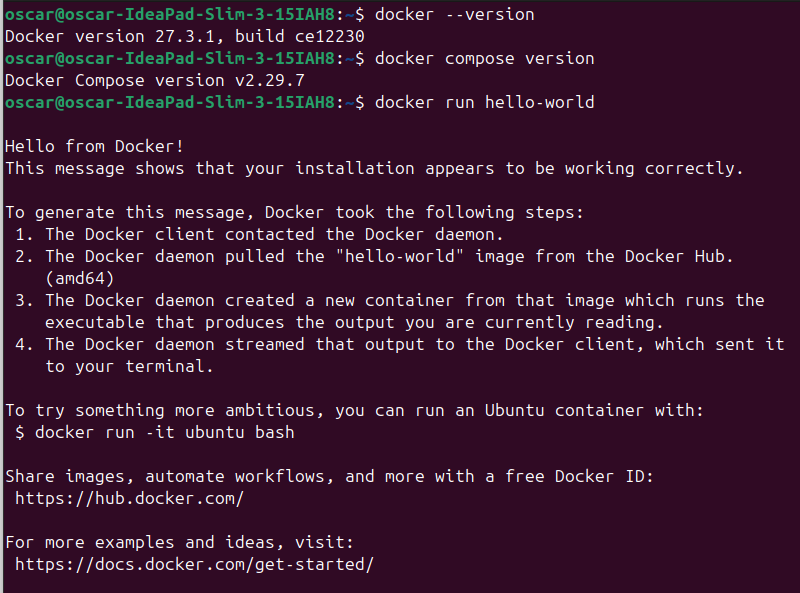

### Parte B

Antes de contenerizar la aplicación, hemos añadido un endpoint de salud para que la API pueda indicar que está lista para recibir peticiones. Para ello añadimos la dependencia `spring-boot-starter-actuator` en el `pom.xml` y configuramos en `application.yml` (el proyecto usa YAML en lugar de `application.properties`) que endpoints se van a exponer:

```yaml
management:
  endpoints:
    web:
      exposure:
        include: health,info
  endpoint:
    health:
      show-details: when-authorized
```


Solo exponemos `health` e `info`, de modo que el resto de endpoints de Actuator (que pueden revelar información sensible del sistema) quedan sin publicar. Además, con `show-details=when-authorized` el detalle del estado solo se muestra a usuarios autorizados, y las peticiones anónimas reciben únicamente el estado global.

Este endpoint es la base de las partes siguientes: lo usarán el `HEALTHCHECK` del Dockerfile (Parte C), las condiciones de arranque de Docker Compose (Parte D) y, más adelante, el pipeline de CI y el despliegue.

Para comprobarlo arrancamos la aplicación en local y consultamos el endpoint, que devuelve `{"status":"UP"}`:

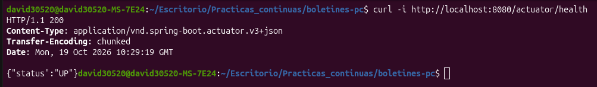

Esta parte corresponde al commit [f5720d0](https://github.com/david30520/boletines-pc/commit/f5720d0) (`feat: añadir endpoint de salud con Actuator`).

### Parte C

Creamos un `Dockerfile` multi-stage en la raíz del proyecto. La primera etapa (`maven:3.9-eclipse-temurin-21`) descarga las dependencias y compila el JAR con Maven; la segunda (`eclipse-temurin:21-jre`) solo copia el JAR resultante. Además, la imagen final instala `curl` (necesario para el `HEALTHCHECK`) y ejecuta la aplicación con un usuario sin privilegios (`app`, UID 1001) en lugar de root. También añadimos un `.dockerignore` para no enviar al contexto de build ficheros innecesarios ni sensibles (`target/`, `.git/`, `.env`, etc.).

Construimos la imagen y arrancamos un contenedor; el endpoint `/api/tasks` responde y, tras el `start-period`, `docker ps` muestra el contenedor como `(healthy)`:

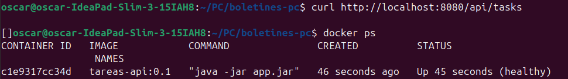

**Comparación de tamaños.** Construimos solo la etapa de build con `--target build`:

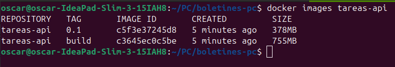

La imagen `tareas-api:build` ocupa 755 MB frente a 378 MB de `tareas-api:0.1`. La diferencia se debe a que la etapa de build contiene el JDK completo, Maven, las dependencias descargadas en `~/.m2`, el código fuente y los artefactos de compilación, mientras que la imagen final solo contiene el JRE, `curl` y el JAR. Además de ahorrar espacio, reduce la superficie de ataque: cada herramienta que no está en la imagen es una vulnerabilidad menos.

**Caché de capas.** Con el orden original (`COPY pom.xml` → descargar dependencias → `COPY src`), al modificar una clase Java Docker reutiliza las capas anteriores (`CACHED`) y solo recompila: el build tardó 11,298s. Al colocar `COPY src` antes de `COPY pom.xml`, cualquier cambio en el código invalida esa capa y todas las posteriores, incluida la descarga de dependencias, que se repite en cada build: tardó 1m 43,562s. Esto confirma la regla de poner arriba lo que cambia poco (`pom.xml`) y abajo lo que cambia mucho (`src/`). Dejamos finalmente el Dockerfile en su orden original.

Esta parte corresponde al commit [fe13a18](https://github.com/david30520/boletines-pc/commit/fe13a18) (`chore: añadir Dockerfile multi-stage y .dockerignore`).

### Parte D

Hasta ahora la API usaba H2 en memoria, por lo que los datos se perdían al parar la aplicación. Para dar persistencia real la migramos a PostgreSQL ejecutado en un segundo contenedor. En el `pom.xml` sustituimos la dependencia de H2 por `org.postgresql:postgresql` y en `application.yml` eliminamos toda la configuración de H2 (URL `jdbc:h2:mem`, usuario `sa`, driver) y cambiamos `ddl-auto` de `create-drop` a `update`, de modo que Hibernate crea las tablas si no existen pero no las borra al parar la aplicación.

Creamos un `docker-compose.yml` con dos servicios:

- **`db`**: imagen `postgres:16`, con un volumen nombrado `db-data` montado en `/var/lib/postgresql/data` para persistir los datos, y un `healthcheck` basado en `pg_isready`. El puerto 5432 solo se publica en `127.0.0.1` para poder conectarse desde la máquina local sin exponer la base de datos a la red.

- **`api`**: se construye con nuestro Dockerfile y recibe la conexión mediante variables de entorno (`SPRING_DATASOURCE_URL`, etc.). Usa `db` como nombre de host, porque Compose crea una red privada en la que cada servicio es alcanzable por su nombre. Con `depends_on` y `condition: service_healthy` la API no arranca hasta que PostgreSQL acepta conexiones, lo que evita errores de conexión en el arranque. No declara healthcheck propio porque hereda el del Dockerfile.

Levantamos el stack con `docker compose up --build -d` y comprobamos que ambos servicios llegan a `(healthy)`:

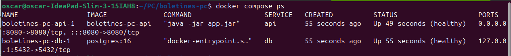

**Comprobación de persistencia.** Insertamos una tarea con `POST /api/tasks`, ejecutamos `docker compose down` y `docker compose up -d`, y la tarea seguía en `GET /api/tasks`:

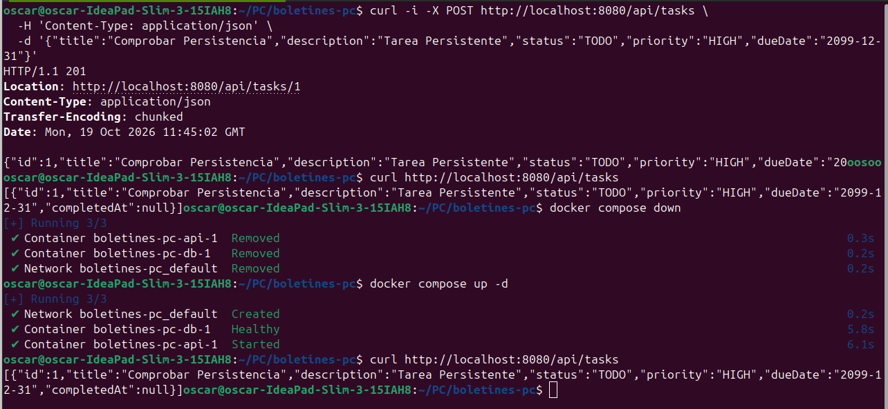

Después repetimos con `docker compose down -v` y la lista volvió vacía:

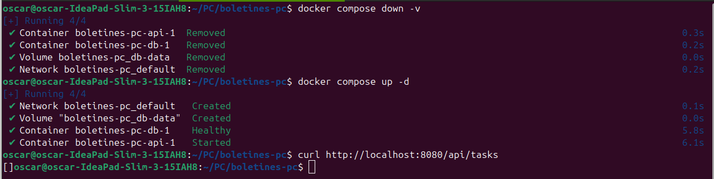

**Diferencia entre `down` y `down -v`.** `docker compose down` detiene y elimina los contenedores y la red creada por Compose, pero conserva los volúmenes nombrados. Como los datos de PostgreSQL están en el volumen `db-data`, al volver a levantar el stack el nuevo contenedor de `db` monta el mismo volumen y recupera la información. `docker compose down -v` elimina además los volúmenes, así que se borran los datos y PostgreSQL inicializa una base de datos nueva y vacía. Un contenedor por sí solo es efímero: lo que sobrevive es lo que está en un volumen.

En este punto el `docker-compose.yml` contiene la contraseña en texto plano, algo que corregimos en la Parte E.

Esta parte corresponde a los commits [037cb6a](https://github.com/david30520/boletines-pc/commit/037cb6a) (migración a PostgreSQL) y [4d7cacf](https://github.com/david30520/boletines-pc/commit/4d7cacf) (`docker-compose.yml`).


### Parte E

El `docker-compose.yml` de la parte anterior tenía la contraseña de PostgreSQL escrita en texto plano y habría acabado en el repositorio. Para separar configuración y código, sacamos las credenciales a un fichero `.env`, que Docker Compose lee automáticamente cuando está junto al `docker-compose.yml`.

Creamos dos ficheros:

- **`.env.example`**: plantilla que sí se versiona. Documenta las variables necesarias (`POSTGRES_DB`, `POSTGRES_USER`, `POSTGRES_PASSWORD`) con valores de ejemplo.
- **`.env`**: copia local con los valores reales, que **no** se sube al repositorio.

Para evitar filtraciones, `.env` está en dos sitios: en el `.gitignore`, para que Git no lo versione, y en el `.dockerignore`, para que no se envíe al contexto de build ni pueda acabar copiado dentro de una imagen publicada.

En el `docker-compose.yml` sustituimos los valores escritos a mano por referencias a variables, usando tres formas distintas:

- **`${VAR}`**: Compose sustituye la variable por su valor antes de crear el contenedor. El valor sale del entorno donde se ejecuta `docker compose` o del `.env`, y las variables del entorno tienen prioridad.
- **`${VAR:?mensaje}`**: exige que la variable exista y no esté vacía; si falta, Compose no arranca y muestra el mensaje. Lo usamos con `POSTGRES_PASSWORD` para fallar pronto y con un error claro.
- **`$${VAR}`**: el `$$` escapa el símbolo, de modo que Compose no sustituye nada y deja `${VAR}` para que lo resuelva el shell dentro del contenedor. Lo usamos en el `healthcheck` de `db`, donde `pg_isready` se ejecuta dentro del contenedor y allí ya existen `POSTGRES_USER` y `POSTGRES_DB`.

Antes de arrancar comprobamos con `docker compose config` que las variables se resuelven correctamente:

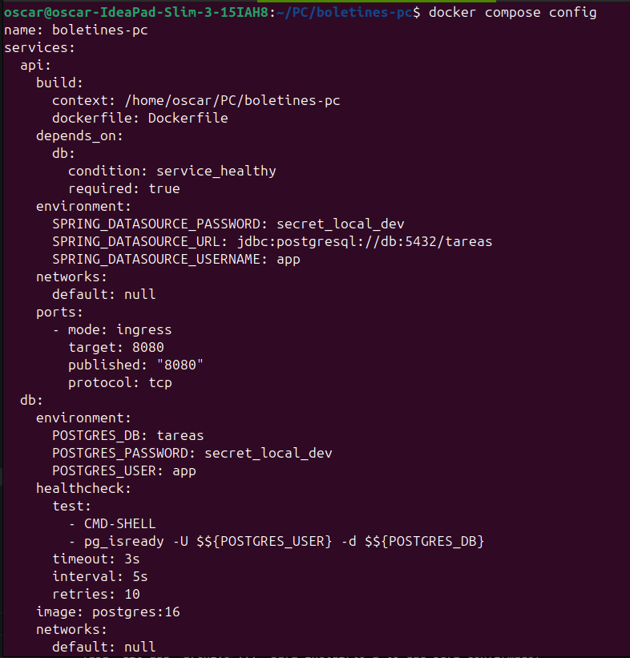

Después partimos de cero con `docker compose down -v`, levantamos el stack con `docker compose up --build -d` y verificamos que todo sigue funcionando:

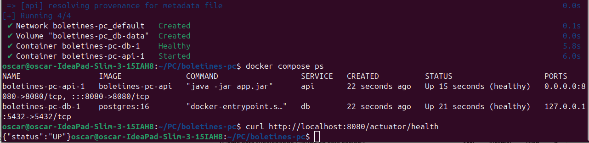

Es importante saber que PostgreSQL solo usa `POSTGRES_USER`, `POSTGRES_PASSWORD` y `POSTGRES_DB` la primera vez que inicializa el volumen. Si se cambia la contraseña en `.env` con el volumen ya creado, la base de datos conserva la antigua y la API no puede conectarse; en desarrollo se soluciona con `docker compose down -v`.

Esta parte corresponde al commit [4d7cacf](https://github.com/david30520/boletines-pc/commit/4d7cacf) (`chore: añadir docker-compose.yml y externalizar credenciales a .env`).

### Parte F

Un *dev container* define el entorno de desarrollo como código: quien clone el repositorio obtiene el mismo JDK, el mismo Maven y las mismas herramientas sin instalar nada en su máquina. Sigue la especificación abierta Dev Containers (soportada por VS Code, GitHub Codespaces y la CLI `devcontainer`). Creamos `.devcontainer/devcontainer.json` con el siguiente significado de cada campo:

- **`name`**: nombre que se muestra del entorno (`tareas-api`).
- **`image`**: imagen base del contenedor de desarrollo, en este caso la de Microsoft con Java 21 y utilidades de desarrollo ya incluidas.
- **`features`**: componentes reutilizables que se instalan sobre la imagen base. Usamos `java` con `installMaven: true` para tener Maven, y `docker-in-docker` para poder usar Docker dentro del contenedor.
- **`forwardPorts`**: puertos del contenedor que se reenvían a la máquina local (8080 de la API y 5432 de PostgreSQL), de modo que son accesibles desde el navegador del host.
- **`postCreateCommand`**: órdenes que se ejecutan una vez, justo después de crear el contenedor.
- **`customizations.vscode.extensions`**: extensiones de VS Code que se instalan automáticamente dentro del entorno (Java Pack y Docker).

**¿Para qué sirve `docker-in-docker`?** El dev container es en sí mismo un contenedor, y por defecto dentro de él no hay un motor de Docker. Esta feature instala y arranca un daemon de Docker dentro del contenedor de desarrollo, lo que permite ejecutar `docker build` y `docker compose up` desde dentro, como necesitamos para levantar la API con PostgreSQL. La opción `"moby": false` indica que se instale Docker CE oficial en lugar de los paquetes de Moby.

**¿Qué hace cada orden de `postCreateCommand`?** Van encadenadas con `;`:

1. `test -f .env || cp .env.example .env`: si no existe el fichero `.env` (que no se versiona), lo crea copiando la plantilla, para que Compose tenga las variables necesarias desde el primer arranque.
2. `if [ -d .githooks ]; then git config core.hooksPath .githooks; fi`: si el repositorio tiene una carpeta `.githooks`, configura Git para usar esos hooks, de manera que todo el equipo los ejecute automáticamente.
3. `mvn -B dependency:go-offline`: descarga de antemano las dependencias de Maven (en modo batch) para que la primera compilación sea más rápida.

Abrimos el proyecto con *Dev Containers: Reopen in Container* y comprobamos que las herramientas están disponibles:

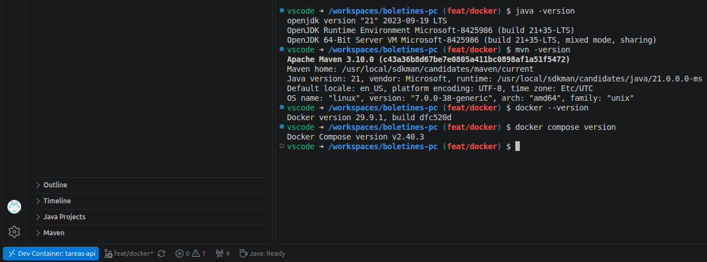

Dentro del dev container ejecutamos `docker compose up --build` y la API respondió desde el navegador de nuestra máquina en `http://127.0.0.1:8080/actuator/health`:

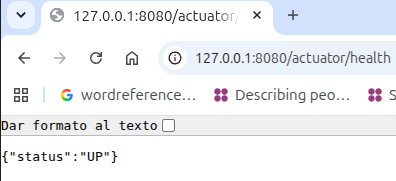

Esta parte corresponde al commit [fb97de5](https://github.com/david30520/boletines-pc/commit/fb97de5) (`chore: configurar entorno de desarrollo con Dev Containers`).


### Parte G

Hemos documentado en el `README.md` cómo levantar el proyecto con Docker y cómo hacerlo con Dev Container.

Ambos hemos trabajado en la rama `feat/docker` y hemos abierto un Pull Request hacia `main` que reúne todos los cambios del boletín: `Dockerfile` y `.dockerignore`, `docker-compose.yml` y `.env.example`, `.gitignore` con `.env`, cambios en `pom.xml` y `application.yml`, `.devcontainer/devcontainer.json` y el `README` actualizado. Antes de abrirlo hemos comprobado que `.env` no estaba versionado.

Esta parte corresponde a los commits [e958a7a](https://github.com/david30520/boletines-pc/commit/e958a7a) (README con Docker), [e1a72b8](https://github.com/david30520/boletines-pc/commit/e1a72b8) (README con Dev Container) y [f64a6c6](https://github.com/david30520/boletines-pc/commit/f64a6c65dee5de03e7a807864ec01e517e32eca1) (Pull Request).

Enlace al Pull Request: [PR](https://github.com/david30520/boletines-pc/pull/10).

### Parte H

Un registry es un servicio que almacena y distribuye imágenes. Docker Hub (`hub.docker.com`) es el público por defecto, y cada imagen se identifica como `<usuario>/<repositorio>:<tag>`.

Para publicar la imagen en Docker Hub seguimos estos pasos.

1. **Autenticación** con `docker login`, usando un *Personal Access Token* en lugar de la contraseña de la cuenta, por ser más seguro:

   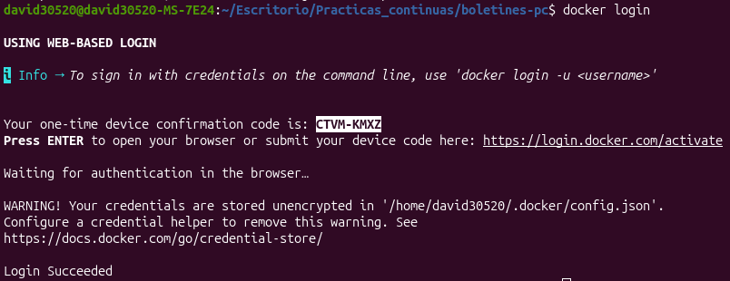

2. **Etiquetado.** La imagen local `tareas-api:0.1` no lleva el nombre del usuario, y Docker necesita ese prefijo para saber a qué repositorio subirla, por lo que creamos un nuevo nombre (alias) que apunta a la misma imagen:

```bash
   docker tag tareas-api:0.1 david30520/tareas-api:0.1
```

3. **Subida** con `docker push`. Solo se suben las capas que el registry no tiene todavía, gracias a la estructura en capas de las imágenes:

```bash
   docker push david30520/tareas-api:0.1
```

   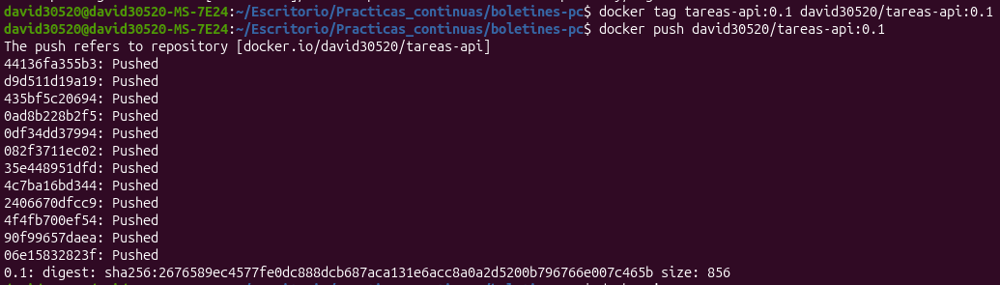

4. **Verificación.** La imagen aparece en el repositorio de Docker Hub con la etiqueta `0.1`:

   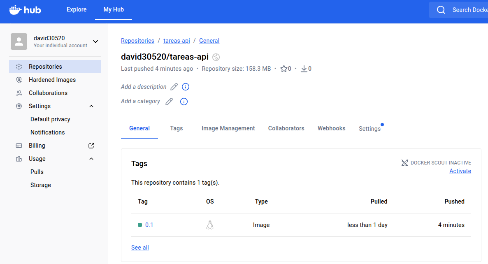

   Para comprobar que es portable, eliminamos la imagen local con `docker rmi` y la descargamos de nuevo con `docker pull david30520/tareas-api:0.1`. 
   
   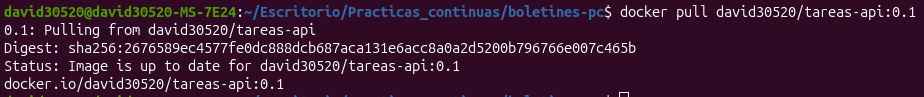

La imagen está publicada en el repositorio público [david30520/tareas-api](https://hub.docker.com/r/david30520/tareas-api) de Docker Hub, con la etiqueta 0.1. Puede descargarse mediante ```docker pull david30520/tareas-api:0.1```, sin disponer del código fuente ni de Maven. Para ejecutar la API es necesario arrancar el contenedor y configurar su conexión con PostgreSQL.

### Parte I

#### 1. Repositorio elegido

Hemos elegido el repositorio público y open source [morluto/rea](https://github.com/morluto/rea), que actualmente supera las 335.000 estrellas en GitHub.

REA (Reverse Engineer Anything) es una herramienta local de ingeniería inversa que permite investigar software desde la terminal o desde agentes de IA mediante una CLI y un servidor MCP. Está desarrollado principalmente en TypeScript para Node.js, con scripts auxiliares JavaScript/MJS, pruebas Python y componentes nativos y puentes en otros lenguajes.

La revisión utilizada es el commit [`ad08510a113d7a9b8d92fb1e385757880e469869`](https://github.com/morluto/rea/commit/ad08510a113d7a9b8d92fb1e385757880e469869). Las fuentes y los comandos de esta sección se refieren a esa revisión.

#### 2. Requisitos y dependencias

| Elemento | Configuración de la revisión analizada |
| --- | --- |
| Lenguaje principal | TypeScript |
| Runtime utilizado | Node.js `24.18.0` |
| Versiones de Node.js admitidas | `^22.19.0`, `^24.11.0` o `>=26.0.0` |
| Gestor de paquetes | npm `11.16.0` |
| Sistema de módulos | ES Modules |
| Fichero de bloqueo de dependencias | `package-lock.json` |
| Framework de tests | Vitest |
| Compilación y coordinación de tareas | TypeScript y Turbo |
| Análisis estático y formato | Oxlint y Oxfmt |
| Pruebas auxiliares | Python 3 |

Fuentes de la revisión utilizada:

- [`.nvmrc`](https://github.com/morluto/rea/blob/ad08510a113d7a9b8d92fb1e385757880e469869/.nvmrc): versión de Node.js.
- [`package.json`](https://github.com/morluto/rea/blob/ad08510a113d7a9b8d92fb1e385757880e469869/package.json): versiones compatibles, gestor de paquetes, dependencias y scripts.
- [`package-lock.json`](https://github.com/morluto/rea/blob/ad08510a113d7a9b8d92fb1e385757880e469869/package-lock.json): versiones resueltas de las dependencias.
- [`docs/testing.md`](https://github.com/morluto/rea/blob/ad08510a113d7a9b8d92fb1e385757880e469869/docs/testing.md): alcance y requisitos de las pruebas.
- [`vitest.config.ts`](https://github.com/morluto/rea/blob/ad08510a113d7a9b8d92fb1e385757880e469869/vitest.config.ts): configuración y grupos de tests.

Entre las dependencias del proyecto se encuentran:

- `vitest` y `@vitest/coverage-v8`: ejecución de tests y cobertura.
- `typescript` y `turbo`: compilación y coordinación de tareas.
- `oxlint` y `oxfmt`: análisis estático y formato.
- `vitepress`: documentación.
- `playwright-core`: funcionalidades relacionadas con el navegador.
- `@modelcontextprotocol/client` y `@modelcontextprotocol/server`: integración MCP.
- `@lydell/node-pty`: soporte para pseudoterminales.
- `frida`: dependencia opcional.

La imagen incorpora Python 3, Git, Bash, `procps`, `build-essential`, `binutils`, `file` y certificados CA. Estas herramientas permiten ejecutar scripts y pruebas, gestionar procesos y disponer de compiladores y utilidades para componentes nativos.

El alcance de esta validación no incluye las comprobaciones que requieren herramientas externas como Ghidra, IDA, Hopper, Android SDK, JDK, Chrome o Xcode.

#### 3. Dockerfile y .dockerignore

La imagen utiliza Node.js `24.18.0` sobre Debian Bookworm e instala npm `11.16.0`. Mantiene las herramientas de desarrollo porque su finalidad es ejecutar pruebas. El comando por defecto es `npm run test:fast`.

```dockerfile
FROM node:24.18.0-bookworm

ENV CI=true \
    HUSKY=0 \
    npm_config_update_notifier=false \
    npm_config_fund=false \
    npm_config_audit=false \
    PLAYWRIGHT_SKIP_BROWSER_DOWNLOAD=1

WORKDIR /workspace

RUN apt-get update \
    && apt-get install --no-install-recommends --yes \
        bash \
        binutils \
        build-essential \
        ca-certificates \
        file \
        git \
        procps \
        python3 \
    && rm -rf /var/lib/apt/lists/*

RUN npm install --global npm@11.16.0

COPY . .

RUN npm ci --include=dev

CMD ["npm", "run", "test:fast"]
```

`npm ci` instala las versiones definidas en `package-lock.json` sin actualizarlo. La opción `--include=dev` incluye expresamente las herramientas de desarrollo necesarias para los tests.

El fichero `.dockerignore` contiene:

```dockerignore
node_modules
dist
coverage
.vitest
.turbo
.cache
.git
.DS_Store
```

Así se excluyen las dependencias locales, los artefactos de compilación, los informes de cobertura, las cachés y el historial de Git. 

#### 4. Tests ejecutados y alcance

Para esta validación hemos ejecutado los siguientes grupos:

| Comando | Alcance |
| --- | --- |
| `npm run test:fast` | Proyectos `domain`, `services`, `adapters`, `composition`, `conformance` y `evaluation`. |
| `npm run test:mcp` | Proyecto `mcp-boundary`. |
| `npm run test:python` | Pruebas Python del productor LLDB con una API simulada; no requieren un depurador LLDB real. |
| `npm run test:acceptance` | Pruebas de aceptación de los flujos de CLI y MCP. |

La validación se limita a estos grupos. Por el tiempo de ejecución, no se incluye la suite completa mediante `npm test`. Quedan fuera otros grupos de Vitest, como `boundary`, `cli-boundary`, `process-boundary` y `process-global`, y las verificaciones con herramientas externas o sistemas operativos específicos. Por tanto, esta prueba no acredita que haya pasado toda la batería de tests del proyecto.

#### 5. Construcción y ejecución

Clonamos el repositorio y seleccionamos la revisión analizada:

```bash
git clone https://github.com/morluto/rea.git
cd rea
git checkout ad08510a113d7a9b8d92fb1e385757880e469869
```

Guardamos el `Dockerfile` y el `.dockerignore` anteriores en la raíz de esta copia local de REA. Este trabajo se realiza fuera del repositorio de la API de tareas.

Construimos la imagen:

```bash
docker build -t rea-tests:node-24.18 .
```

Durante la construcción se instalan las herramientas del sistema y las dependencias del proyecto. Los tests se ejecutan al arrancar el contenedor.

Para ejecutar `test:fast`, utilizamos el comando por defecto:

```bash
docker run --rm --init rea-tests:node-24.18
```

Para ejecutar los otros grupos, sustituimos el comando por defecto:

```bash
# Pruebas MCP
docker run --rm --init rea-tests:node-24.18 npm run test:mcp

# Pruebas Python
docker run --rm --init rea-tests:node-24.18 npm run test:python

# Pruebas de aceptación
docker run --rm --init rea-tests:node-24.18 npm run test:acceptance
```

`--rm` elimina el contenedor al finalizar y `--init` incorpora un proceso de inicialización que reenvía señales y recoge procesos hijos terminados.

#### 6. Resultados

La siguiente captura recoge la salida obtenida al ejecutar `test:fast`:

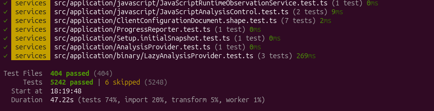

La siguiente captura recoge la salida obtenida al ejecutar `test:mcp`:

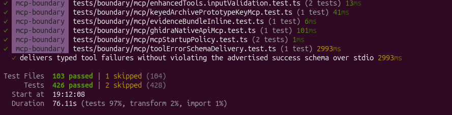

La siguiente captura recoge la salida obtenida al ejecutar `test:python`:

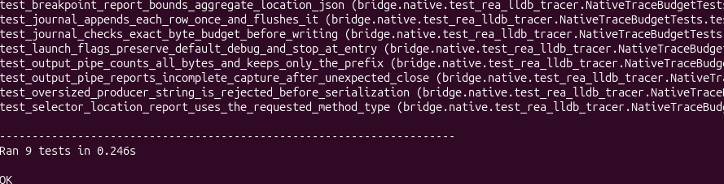

La siguiente captura recoge la salida obtenida al ejecutar `test:acceptance`:

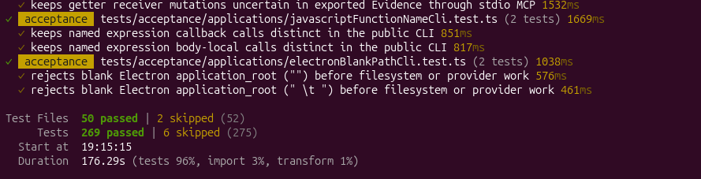


