# Boletín 4

## Resumen de commits

| # | Mensaje del commit | Qué se hizo | Autor | Enlace |
|---|--------------------|-------------|-------|--------|
| 1 | `ci: añade workflow de integración continua con Maven (#12)` | Creación de `.github/workflows/ci.yml` con un job `build` que compila y ejecuta los tests con `mvn verify` | oscarab6 | [b6b9a09](https://github.com/david30520/boletines-pc/commit/b6b9a0960d0759b51a367c37c478d5f4f5bd7d81) |
| 2 | `test: provocar un fallo para comprobar el CI` | Se rompe un test (rama `test/ci-parte-b`) para comprobar que el CI falla al abrir el PR | David Abellán Bleda | [cbacc18](https://github.com/david30520/boletines-pc/commit/cbacc18f9e6e7cd118be742d876f5a6ec714a595) |
| 3 | `fix: corrige test roto` | Se restaura el caso original (añadiendo el comentario `// arreglado`) y el CI del mismo PR pasa a verde | oscarab6 | [6211c34](https://github.com/david30520/boletines-pc/commit/6211c3462b81749e4d766fa33f864d925022793b) |
| 4 | `test: provocar un fallo para comprobar el CI (#13)` | Commit de *squash and merge* del PR #13 en `main`, que reúne los commits 2 y 3 | David Abellán Bleda y oscarab6 | [ac5c674](https://github.com/david30520/boletines-pc/commit/ac5c6746d3f7b9c727bf1a5c090a203ec06db087) |
| 5 | `ci: separa el pipeline en jobs lint, test y package` | Se divide el workflow en tres jobs encadenados con `needs`: `lint`, `test` (con informe JUnit) y `package` (con subida del JAR) | oscarab6 | [bced1e9](https://github.com/david30520/boletines-pc/commit/bced1e9f62b9f2a009bfb211575a8986fb265f9a) |
| 6 | `style: desordena clase para provocar fallo de formato` | Se desordena el formato de una clase y se sube con `--no-verify` para que falle el job `lint` | David Abellán Bleda | [fcb0d0c](https://github.com/david30520/boletines-pc/commit/fcb0d0ccab751faf52f5000e139a9ee7fc121ed2) |
| 7 | `style: corrige formato de la clase` | Se corrige el formato con Spotless y el pipeline vuelve a pasar en verde | David Abellán Bleda | [81bc866](https://github.com/david30520/boletines-pc/commit/81bc866eb9b5150bfcf909da2b8e0c02da51dd3f) |
| 8 | `ci: separa el pipeline en jobs lint, test y package (#14)` | Commit de *squash and merge* del PR #14 en `main`, que reúne los commits 5, 6 y 7 | oscarab6 y David Abellán Bleda | [d5798e8](https://github.com/david30520/boletines-pc/commit/d5798e8e6e6a88ae020177072da36eb0275fc7f5) |
| 9 | `test: rompe test para comprobar que main está protegida` | Se rompe un test en la rama `feat/ci-parte-d` para comprobar que, con la protección de `main` activa, GitHub bloquea la fusión del PR #15 (cerrado sin fusionar) | oscarab6 | [a121d94](https://github.com/david30520/boletines-pc/commit/a121d9402a7458ad0e543e90e2e0fddf714b4b4e) |
| 10 | `ci: añade revisión de PR con IA (#16)` | Nuevo workflow que resume cada PR con un modelo de Ollama Cloud; el secreto con la API key se gestiona con GitHub Secrets | oscarab6 | [80fda03](https://github.com/david30520/boletines-pc/commit/80fda0361d8f33a71b82300d1ff57a23a1dd7fec) |
| 11 | `docs: añade badge de CI al README (#17)` | Se añade al README el badge con el estado del workflow `CI` | David Abellán Bleda | [91f8a2e](https://github.com/david30520/boletines-pc/commit/91f8a2ec2ce6fa339a1ce57b388e1ab628104b31) |

## Detalle por commit

### 1. `ci: añade workflow de integración continua con Maven (#12)`
- **Qué se hizo:** Se creó `.github/workflows/ci.yml` en la rama `feat/ci-parte-a` y se integró en `main` mediante el [PR #12](https://github.com/david30520/boletines-pc/pull/12) (*squash and merge*). Define los triggers (`push` a `main` y `pull_request`), un grupo de `concurrency` que cancela ejecuciones obsoletas, permisos mínimos (`contents: read`) y un job `build` en `ubuntu-latest` (`timeout-minutes: 15`) que hace checkout, configura Temurin JDK 21 con caché de Maven y ejecuta `mvn --batch-mode verify`.
- **Autor:** oscarab6.
- **Relación con el boletín:** Parte A (primer pipeline de CI).
- **Uso de IA:** no se ha usado.

### 2. `test: provocar un fallo para comprobar el CI`
- **Qué se hizo:** En la rama `test/ci-parte-b` se rompió uno de los tests (`TaskStatusTest`, caso `TODO, DONE`, cambiando el resultado esperado de `false` a `true`) para comprobar que el check `build` del CI falla al abrir el PR.
- **Autor:** David Abellán Bleda.
- **Relación con el boletín:** Parte B (demostrar que el CI atrapa errores).
- **Uso de IA:** no se ha usado.

### 3. `fix: corrige test roto`
- **Qué se hizo:** Se restauró el valor original del caso `TODO, DONE` (`false`), añadiendo el comentario `// arreglado`, y se hizo push a la misma rama. El workflow se volvió a ejecutar en el mismo PR y el check pasó a verde.
- **Autor:** oscarab6.
- **Relación con el boletín:** Parte B (demostrar que el CI atrapa errores).
- **Uso de IA:** no se ha usado.

### 4. `test: provocar un fallo para comprobar el CI (#13)`
- **Qué se hizo:** Commit generado por GitHub al hacer *squash and merge* del [PR #13](https://github.com/david30520/boletines-pc/pull/13) desde la rama `test/ci-parte-b` a `main`. Reúne los commits 2 y 3 y su cambio neto es una sola línea de `TaskStatusTest` (el comentario `// arreglado`). Incluye a oscarab6 como coautor.
- **Autor:** David Abellán Bleda y oscarab6.
- **Relación con el boletín:** Parte B.
- **Uso de IA:** no se ha usado.

### 5. `ci: separa el pipeline en jobs lint, test y package`
- **Qué se hizo:** En la rama `feat/ci-parte-c` se reestructuró `ci.yml` en tres jobs encadenados con `needs`: `lint` (`mvn -B spotless:check`), `test` (`mvn -B verify` y publicación del informe JUnit con `dorny/test-reporter`) y `package` (`mvn -B package -DskipTests` y subida del JAR como artefacto `app-jar`). Se ampliaron los permisos con `actions: read` y `checks: write`.
- **Autor:** oscarab6.
- **Relación con el boletín:** Parte C (separar responsabilidades en jobs).
- **Uso de IA:** no se ha usado.

### 6. `style: desordena clase para provocar fallo de formato`
- **Qué se hizo:** En la misma rama `feat/ci-parte-c` se desordenó el formato de una clase y se hizo el commit con `--no-verify` para saltarse el hook de pre-commit. Con ello el job `lint` falló y `test` y `package` no se ejecutaron.
- **Autor:** David Abellán Bleda.
- **Relación con el boletín:** Parte C (comprobar que `lint` frena el pipeline).
- **Uso de IA:** no se ha usado.

### 7. `style: corrige formato de la clase`
- **Qué se hizo:** Se corrigió el formato de la clase con Spotless y se hizo push a la misma rama; el pipeline volvió a ejecutarse completo (`lint`, `test`, `package`) en verde.
- **Autor:** David Abellán Bleda.
- **Relación con el boletín:** Parte C.
- **Uso de IA:** no se ha usado.

### 8. `ci: separa el pipeline en jobs lint, test y package (#14)`
- **Qué se hizo:** Commit generado por GitHub al hacer *squash and merge* del [PR #14](https://github.com/david30520/boletines-pc/pull/14) desde la rama `feat/ci-parte-c` a `main`. Reúne los commits 5, 6 y 7: los dos últimos se anulan entre sí (desorden y corrección del formato), por lo que lo que queda en `main` es la reestructuración del workflow.
- **Autor:** oscarab6 y David Abellán Bleda.
- **Relación con el boletín:** Parte C.
- **Uso de IA:** no se ha usado.

### 9. `test: rompe test para comprobar que main está protegida`
- **Qué se hizo:** En la rama `feat/ci-parte-d` se cambió la aserción de un test para que fallara y se abrió el [PR #15](https://github.com/david30520/boletines-pc/pull/15). Con la protección de `main` activa, el check `test` terminó en rojo, `package` no llegó a ejecutarse y GitHub bloqueó la fusión. El PR se cerró sin fusionar, por lo que este commit solo existe en la rama.
- **Autor:** oscarab6.
- **Relación con el boletín:** Parte D (convertir el CI en una barrera).
- **Uso de IA:** no se ha usado.

### 10. `ci: añade revisión de PR con IA (#16)`
- **Qué se hizo:** Commit generado por GitHub al hacer *squash and merge* del [PR #16](https://github.com/david30520/boletines-pc/pull/16) desde la rama `feat/ci-parte-e-ia`. Añade el workflow `ia-review.yml`, que en cada PR obtiene el diff con `gh pr diff`, lo envía a la API de Ollama Cloud y publica un comentario con un resumen en lenguaje natural. La API key se guarda como secreto del repositorio (`OLLAMA_API_KEY`) y no está en el código.
- **Autor:** oscarab6.
- **Relación con el boletín:** Parte E (gestión de secretos y revisión con IA).
- **Uso de IA:** Claude (claude.ai), para diseñar el workflow y la gestión del secreto. Prompt: "vamos con la parte final E".

### 11. `docs: añade badge de CI al README (#17)`
- **Qué se hizo:** Commit generado por GitHub al hacer *squash and merge* del [PR #17](https://github.com/david30520/boletines-pc/pull/17) desde la rama `feat/ci-parte-e-badge`. Añade al `README.md` el badge del workflow `ci.yml`, enlazado a la página de ejecuciones en Actions.
- **Autor:** David Abellán Bleda.
- **Relación con el boletín:** Parte E (badge del estado del CI).
- **Uso de IA:** Claude (claude.ai), para obtener la sintaxis del badge. Prompt: "vamos con la parte final E".

## Descripción narrativa de lo hecho en la sesión y relación con los commits

### Parte A

Para esta parte se creó la rama `feat/ci-parte-a` a partir de `main`. Sobre esa rama se añadió el workflow `ci.yml` en `.github/workflows/` y se subió al repositorio. Después se abrió un [Pull Request](https://github.com/david30520/boletines-pc/pull/12), que fue revisado antes de fusionarlo en `main`.

El workflow contiene un único job `build` que se ejecuta en `ubuntu-latest` con un `timeout-minutes: 15`, instala Temurin JDK 21 con caché de Maven y lanza `mvn --batch-mode verify`, que compila el proyecto y ejecuta los tests. Al abrir el PR, el workflow se disparó automáticamente y el job `build` terminó en verde (33 s).

**¿Qué sentido tiene el campo `concurrency`?**

Agrupa las ejecuciones por referencia de Git (`ci-${{ github.ref }}`), es decir, por rama o PR, y con `cancel-in-progress: true` cancela la ejecución en curso de ese grupo cuando llega un push nuevo. Así no se gastan minutos de runner validando commits obsoletos y solo importa el resultado del último commit. Ramas distintas tienen grupos distintos y no se cancelan entre sí.

**¿Cuándo se dispara el workflow?**
- En cada `push` a la rama `main`.
- En cada evento de `pull_request` (por defecto: al abrirlo, al subir nuevos commits a su rama y al reabrirlo), sea cual sea la rama destino.

Además, un push a una rama sin PR abierto no lo dispara.

Esta parte corresponde al commit [b6b9a09](https://github.com/david30520/boletines-pc/commit/b6b9a0960d0759b51a367c37c478d5f4f5bd7d81), que es el commit que *squash and merge* genera al fusionar el PR.

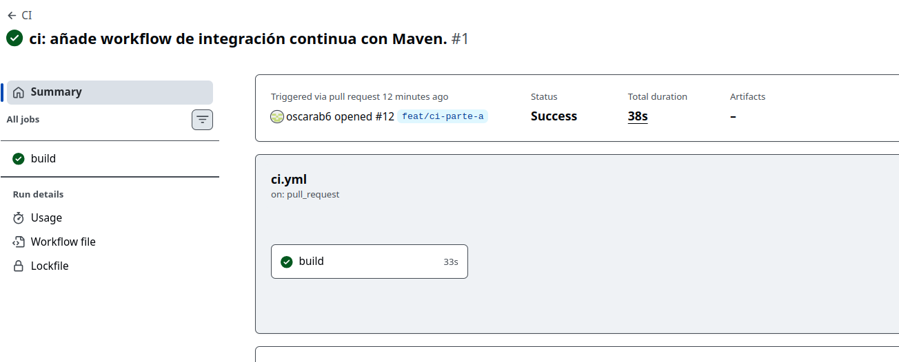

### Parte B

El objetivo de esta parte es demostrar que el CI detecta un test fallido y vuelve a pasar después de corregirlo. La prueba se realizó en la rama `test/ci-parte-b`, utilizando el workflow de la Parte A y su job `build`.

**Test elegido**

El archivo `src/test/java/com/example/tasks/domain/TaskStatusTest.java` contiene un test parametrizado de las transiciones entre estados. El caso elegido comprueba que no se permite pasar directamente de `TODO` a `DONE`.

El commit [cbacc18](https://github.com/david30520/boletines-pc/commit/cbacc18f9e6e7cd118be742d876f5a6ec714a595) cambia únicamente el resultado esperado de ese caso para que falle:

```diff
-    "TODO, DONE, false",
+    "TODO, DONE, true",
```

En este punto el fallo es intencionado y por tanto al pasar los tests obtenemos un error:

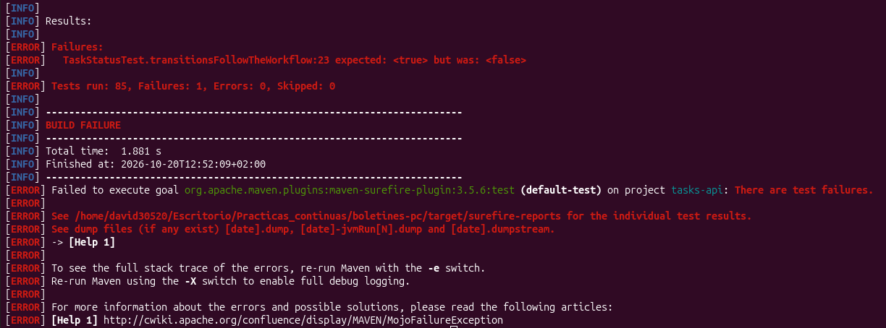

**PR y primera ejecución del CI**

Tras subir la rama, se abrió el [PR #13](https://github.com/david30520/boletines-pc/pull/13) con destino `main`. Con la apertura del PR se dispara el workflow y el job `build` ejecuta `mvn --batch-mode verify` en el paso **Construir y testear**.

El resultado es un check rojo causado por el fallo de `TaskStatusTest`:

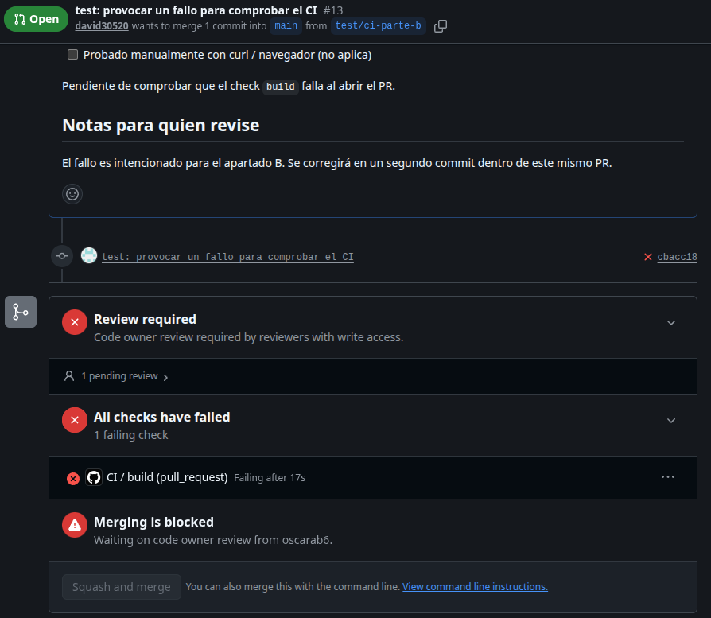

**Corrección y segunda ejecución**

El commit [6211c34](https://github.com/david30520/boletines-pc/commit/6211c3462b81749e4d766fa33f864d925022793b) restaura la expectativa original y añade un comentario:

```java
"TODO, DONE, false", // arreglado
```

Al hacer push a la misma rama, el workflow se ejecutó de nuevo en el mismo PR y el check del CI pasó a verde:

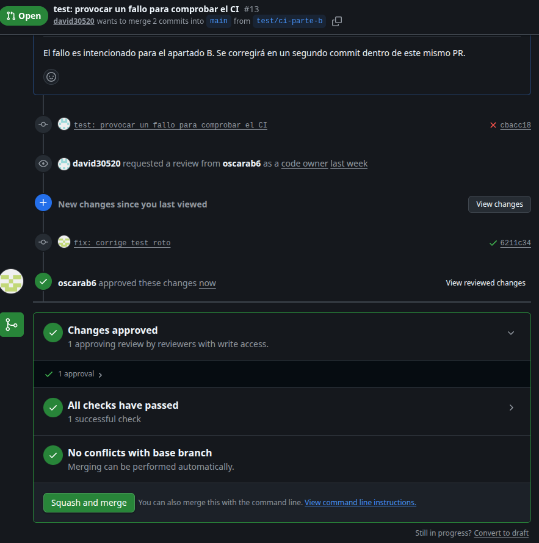

Como el cambio neto de ambos commits es una sola línea (el comentario), el PR se pudo fusionar en `main` mediante *squash and merge*. Esta parte corresponde al commit [ac5c674](https://github.com/david30520/boletines-pc/commit/ac5c6746d3f7b9c727bf1a5c090a203ec06db087), que es el que genera la fusión; los dos commits de la rama son [cbacc18](https://github.com/david30520/boletines-pc/commit/cbacc18f9e6e7cd118be742d876f5a6ec714a595) y [6211c34](https://github.com/david30520/boletines-pc/commit/6211c3462b81749e4d766fa33f864d925022793b).

### Parte C

Se creó la rama `feat/ci-parte-c` y se reestructuró el workflow `ci.yml` en tres jobs encadenados con `needs`: `lint`, `test` y `package`. Al abrir el [Pull Request #14](https://github.com/david30520/boletines-pc/pull/14), los tres jobs se ejecutaron en orden y terminaron en verde. El job `test` publicó el informe de resultados JUnit y `package` subió el JAR como artefacto `app-jar`.

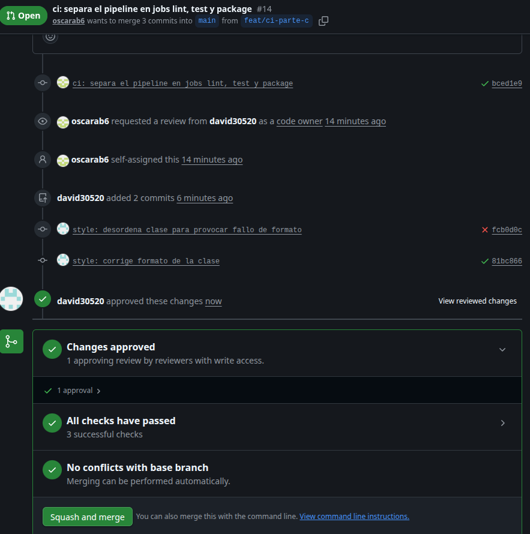

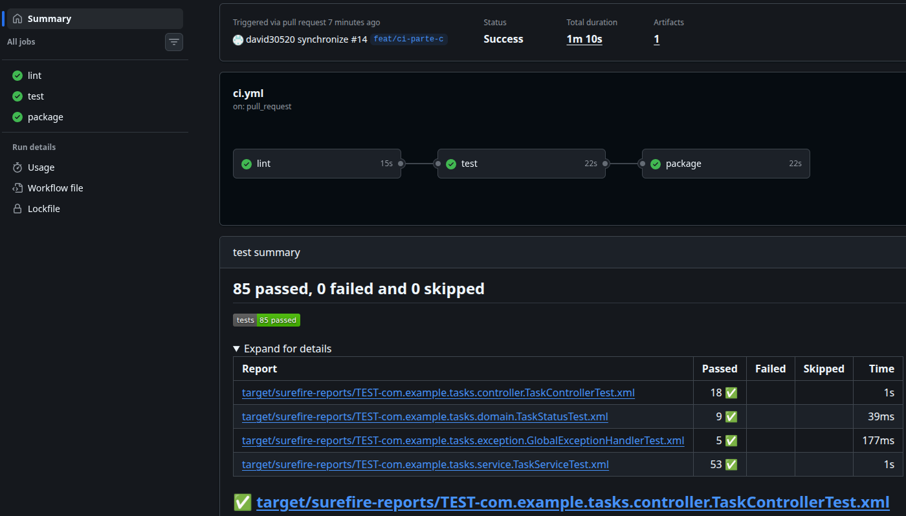

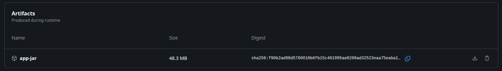

Cada job tiene una responsabilidad:

| Job | Función | Dependencia |
|---|---|---|
| `lint` | Comprueba el formato con Spotless, sin corregir los archivos. | Ninguna. |
| `test` | Construye y verifica el proyecto con Maven y publica el informe JUnit. | `lint` debe terminar correctamente. |
| `package` | Genera el JAR sin volver a ejecutar los tests y lo publica como artefacto. | `test` debe terminar correctamente. |

Para comprobar que `lint` frena el pipeline, se desordenó una clase y se subió con `git commit --no-verify`, saltándose el hook de pre-commit. El job `lint` falló y `test` y `package` ni siquiera se ejecutaron, porque dependen de él mediante `needs`.

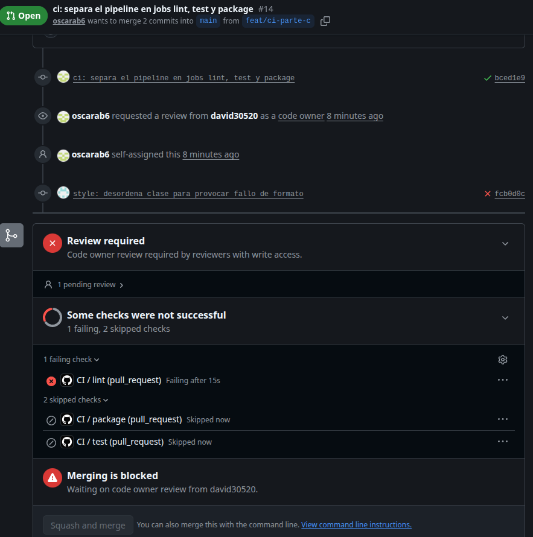

Después se corrigió el formato con `mvn spotless:apply` y se hizo push a la misma rama, con lo que el pipeline volvió a ejecutarse completo en verde.

**¿Por qué es útil que `lint` vaya primero?**

Es el job más barato y rápido, así que si el formato es incorrecto el pipeline falla en segundos y no se gastan minutos de runner compilando y ejecutando tests que de todos modos habría que repetir. Además da un mensaje de error más claro: el fallo apunta directamente a la causa.

**¿Por qué el paso del informe lleva `if: always()`?**

Si algún test falla, el paso `mvn verify` termina con error y, por defecto, los pasos siguientes se saltan. Con `if: always()` el informe se publica igualmente, y es justo cuando hay fallos cuando más interesa ver qué test falló y por qué.

**¿Por qué `package` debe volver a construir el proyecto si `test` ya ejecutó `mvn verify`?**

Porque cada job se ejecuta en un runner distinto y limpio, que no hereda los archivos de `target/` del job anterior. `package` tiene que partir de cero (con la caché de Maven acelerando la descarga de dependencias) y, al usar `-DskipTests`, solo compila y empaqueta.

**¿Cómo podrían compartirse los archivos generados entre ambos jobs?**

Subiendo `target/` (o solo el JAR) como artefacto en el job `test` con `actions/upload-artifact` y descargándolo en `package` con `actions/download-artifact`. Así `package` reutiliza lo ya construido y no recompila. También se puede usar la caché de Actions, aunque los artefactos son lo más adecuado para pasar resultados entre jobs de la misma ejecución.

Tras la revisión, el PR se fusionó en `main` mediante *squash and merge*. Esta parte corresponde al commit [d5798e8](https://github.com/david30520/boletines-pc/commit/d5798e8e6e6a88ae020177072da36eb0275fc7f5), que es el que genera la fusión; los tres commits de la rama son [bced1e9](https://github.com/david30520/boletines-pc/commit/bced1e9f62b9f2a009bfb211575a8986fb265f9a) (workflow), [fcb0d0c](https://github.com/david30520/boletines-pc/commit/fcb0d0ccab751faf52f5000e139a9ee7fc121ed2) (formato desordenado) y [81bc866](https://github.com/david30520/boletines-pc/commit/81bc866eb9b5150bfcf909da2b8e0c02da51dd3f) (formato corregido).

### Parte D

Una vez fusionado el PR de la Parte C, y con los checks `lint`, `test` y `package` ya ejecutados al menos una vez, se editó la protección de `main` creada en el Boletín 2 desde **Settings → Branches**. Se activó **Require status checks to pass before merging**, se seleccionaron los tres checks como obligatorios, se marcó **Require branches to be up to date before merging** (obliga a actualizar la rama del PR respecto a `main` si esta ha avanzado) y se comprobó que **Do not allow bypassing the above settings** estaba activada, de modo que la regla también se aplica a los administradores.

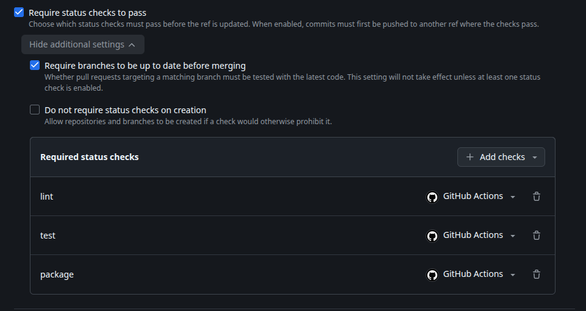

Para verificarlo se creó la rama `feat/ci-parte-d`, se rompió un test a propósito y se abrió el [Pull Request #15](https://github.com/david30520/boletines-pc/pull/15). El job `lint` terminó en verde, `test` en rojo y `package` no se ejecutó, y GitHub deshabilitó el botón de fusión indicando que los checks obligatorios no se cumplían. La fusión también quedó bloqueada para el administrador del repositorio.

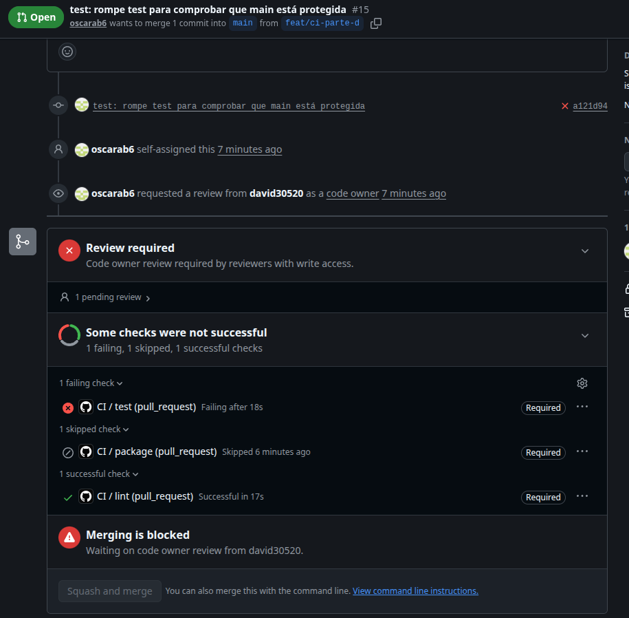

El PR se cerró sin fusionar para no introducir el test roto en `main`. Esta parte corresponde al commit [a121d94](https://github.com/david30520/boletines-pc/commit/a121d9402a7458ad0e543e90e2e0fddf714b4b4e), que existe solo en la rama `feat/ci-parte-d`.

### Parte E

**Revisión de PRs con IA y gestión de secretos.** Se creó un workflow independiente, `ia-review.yml`, que se dispara en cada Pull Request. Obtiene los cambios con `gh pr diff`, los envía a un modelo de Ollama Cloud y publica en el PR un comentario con un resumen en lenguaje natural de lo modificado.

La API key de Ollama no puede estar en el repositorio, así que se guardó como secreto en **Settings → Secrets and variables → Actions** con el nombre `OLLAMA_API_KEY`. El workflow la lee como `${{ secrets.OLLAMA_API_KEY }}` y la recibe en una variable de entorno; GitHub la enmascara en los logs y no se puede leer una vez guardada. Los PRs procedentes de forks no tienen acceso a los secretos.

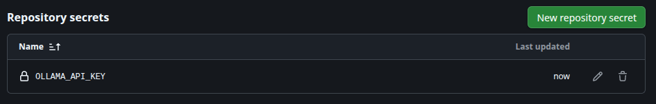

Al abrir el [Pull Request #16](https://github.com/david30520/boletines-pc/pull/16), el workflow publicó el resumen generado por la IA.

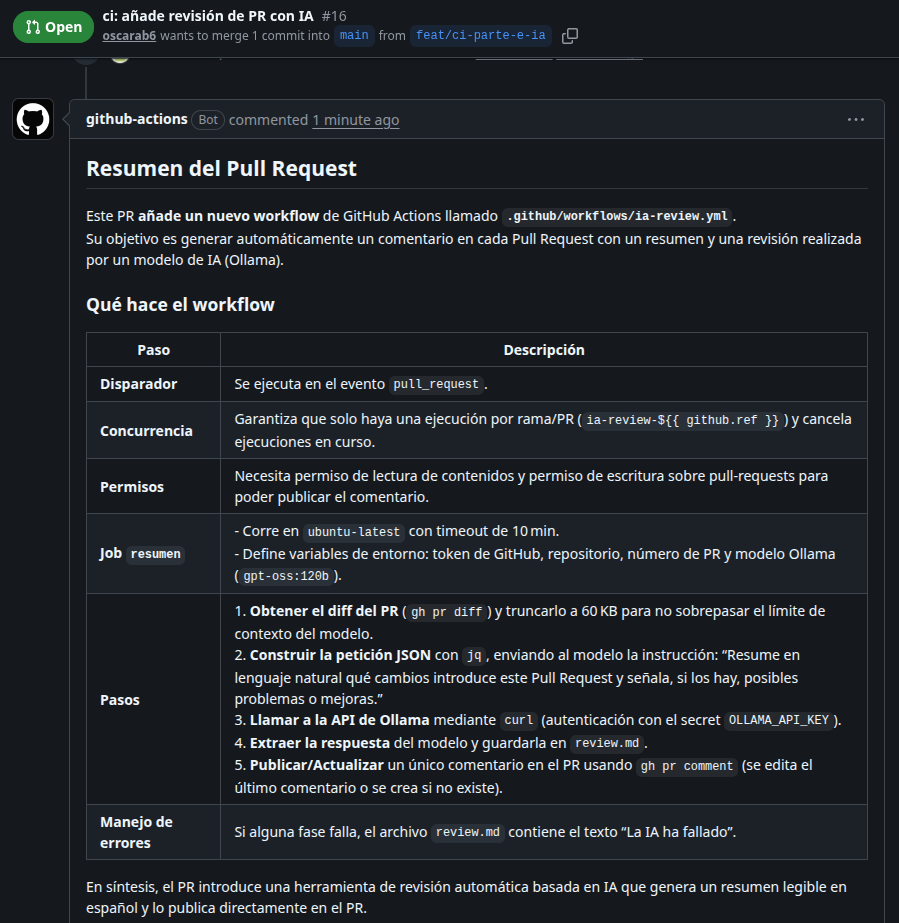

**Badge del CI.** Se añadió al `README.md` el badge del workflow `ci.yml`, que muestra el estado de la última ejecución en `main` y enlaza a la pestaña Actions ([PR #17](https://github.com/david30520/boletines-pc/pull/17)).

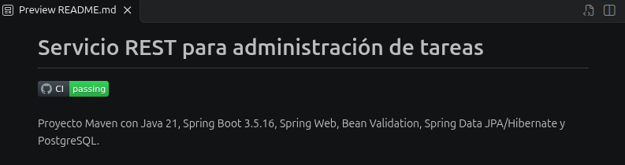

Esta parte corresponde a los commits [80fda03](https://github.com/david30520/boletines-pc/commit/80fda0361d8f33a71b82300d1ff57a23a1dd7fec) (revisión con IA) y [91f8a2e](https://github.com/david30520/boletines-pc/commit/91f8a2ec2ce6fa339a1ce57b388e1ab628104b31) (badge), generados al fusionar cada PR con *squash and merge*. Como en cada rama solo hubo un commit, se documenta únicamente el de `main`; los de las ramas siguen disponibles en `feat/ci-parte-e-ia` y `feat/ci-parte-e-badge`.
