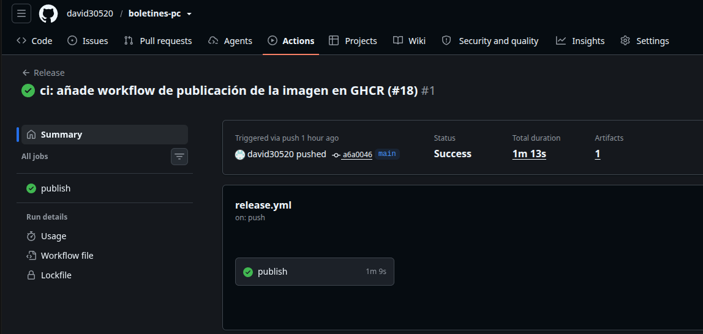
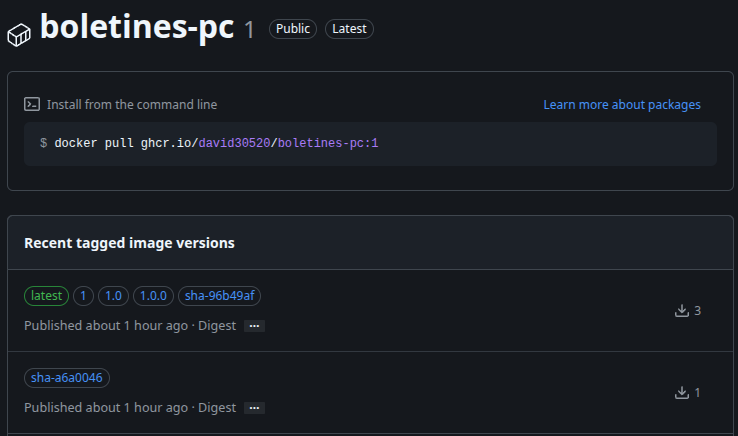
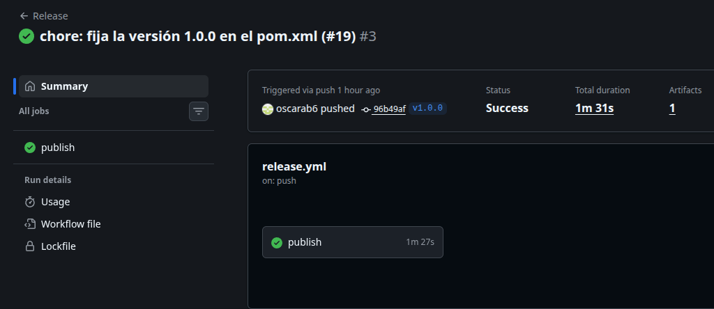
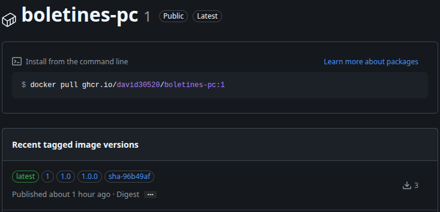
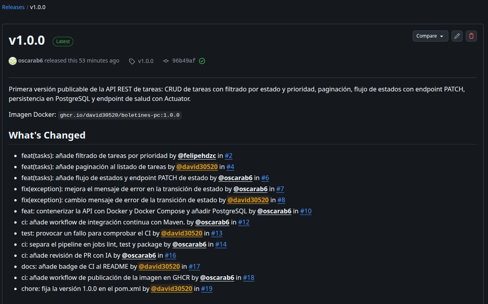
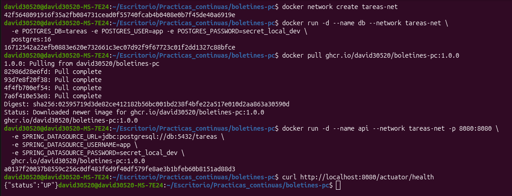
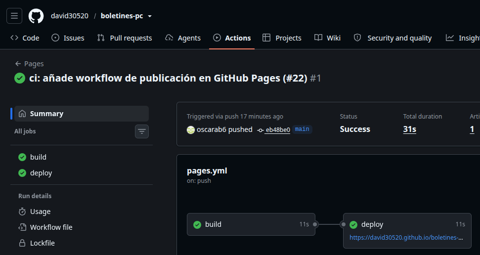
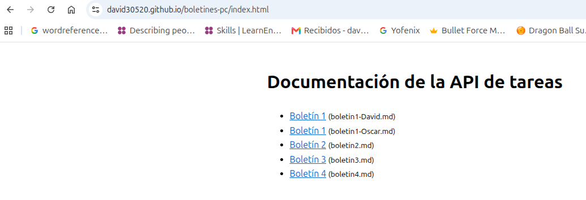

# Boletín 5

## Resumen de commits

| # | Mensaje del commit | Qué se hizo | Autor | Enlace |
|---|--------------------|-------------|-------|--------|
| 1 | `ci: añade workflow de publicación de la imagen en GHCR (#18)` | Workflow `release.yml` que construye la imagen Docker y la publica en GHCR con tags `sha-`, SemVer y `latest` | oscarab6 | [a6a0046](https://github.com/david30520/boletines-pc/commit/a6a0046c31e124494fbab055555316e93ebbde2b) |
| 2 | `chore: fija la versión 1.0.0 en el pom.xml (#19)` | Cambio de la versión del proyecto en el `pom.xml` de `0.0.1-SNAPSHOT` a `1.0.0`, sobre el que se crea la etiqueta `v1.0.0` | David Abellán Bleda | [96b49af](https://github.com/david30520/boletines-pc/commit/96b49afe7abd8bacc2ff1a26508304eb4975fc7f) |
| 3 | `docs: añade las memorias de los boletines 1 a 4 (#20)` | Carpeta `docs/` con las memorias de los boletines 1 a 4 y sus capturas | David Abellán Bleda | [86a7f99](https://github.com/david30520/boletines-pc/commit/86a7f99c30e807e1efca4ab3cc56a7a570d7d9ad) |
| 4 | `docs: añade script que genera la web de la documentación (#21)` | Script `docs/generar_site.py` que genera `docs/site/` con un HTML por cada md y un índice | oscarab6 | [786dec4](https://github.com/david30520/boletines-pc/commit/786dec4815f6b714b1501d586c646eb9167307cf) |
| 5 | `ci: añade workflow de publicación en GitHub Pages (#22)` | Workflow `pages.yml` que en cada push a `main` genera la web con el script y la publica en GitHub Pages | David Abellán Bleda | [eb48be0](https://github.com/david30520/boletines-pc/commit/eb48be0bc02e560f6f8b41e989a2f31ac368009f) |

## Detalle por commit

### 1. `ci: añade workflow de publicación de la imagen en GHCR (#18)`
- **Qué se hizo:** se añadió el workflow `.github/workflows/release.yml`, que se ejecuta con cada push a `main` y con cada etiqueta `v*.*.*`. Hace login en `ghcr.io` con el `GITHUB_TOKEN`, calcula los tags de la imagen con `docker/metadata-action` (`sha-<commit>`, `X.Y.Z`, `X.Y`, `X` y `latest`) y construye y publica la imagen con `docker/build-push-action` usando el `Dockerfile` del repositorio. Los permisos se limitan a `contents: read` y `packages: write`. PR [#18](https://github.com/david30520/boletines-pc/pull/18).
- **Autor:** oscarab6
- **Relación con el boletín:** apartado 3, Parte A: pipeline de publicación de la imagen en GitHub Container Registry.
- **Uso de IA:** no se ha usado.

### 2. `chore: fija la versión 1.0.0 en el pom.xml (#19)`
- **Qué se hizo:** se cambió la versión de `tasks-api` en el `pom.xml` de `0.0.1-SNAPSHOT` a `1.0.0`, para que coincidan la versión del JAR, la de la etiqueta Git `v1.0.0` y la de la imagen publicada. Sobre este commit se creó después la etiqueta anotada `v1.0.0` y la Release. PR [#19](https://github.com/david30520/boletines-pc/pull/19).
- **Autor:** David Abellán Bleda
- **Relación con el boletín:** apartado 3, Parte B: publicación de la primera versión con SemVer.
- **Uso de IA:** no se ha usado.

### 3. `docs: añade las memorias de los boletines 1 a 4 (#20)`
- **Qué se hizo:** se creó la carpeta `docs/` en la raíz del repositorio con las memorias de los boletines 1 a 4 y todas sus capturas, en la misma carpeta que los md, para poder generar a partir de ellas la web de documentación. PR [#20](https://github.com/david30520/boletines-pc/pull/20).
- **Autor:** David Abellán Bleda
- **Relación con el boletín:** apartado 3, Parte D: traer las memorias de cada sesión al repositorio de la API.
- **Uso de IA:** no se ha usado.

### 4. `docs: añade script que genera la web de la documentación (#21)`
- **Qué se hizo:** se añadió `docs/generar_site.py`, un script en Python que lee todos los `.md` de `docs/`, genera en `docs/site/` un `.html` por cada uno (con `markdown-it-py`, que sigue CommonMark como GitHub), copia las imágenes y crea un `index.html` que enlaza a todas las páginas. Se añadió `docs/requirements.txt` con la dependencia y `docs/site/` al `.gitignore`. PR [#21](https://github.com/david30520/boletines-pc/pull/21).
- **Autor:** oscarab6
- **Relación con el boletín:** apartado 3, Parte D: script que genera la web de la documentación a partir de los md.
- **Uso de IA:** se ha usado Claude con el prompt: «genera un script en python que lea todos los .md de docs/ y genere, para cada uno, un .html equivalente más un index.html que enlace a todos. Deben guardarse en docs/site/».

### 5. `ci: añade workflow de publicación en GitHub Pages (#22)`
- **Qué se hizo:** se añadió el workflow `.github/workflows/pages.yml`, que se ejecuta en cada push a `main` (y a mano con `workflow_dispatch`). El job `build` instala Python y `markdown-it-py`, ejecuta `docs/generar_site.py` y sube `docs/site/` como artefacto de Pages; el job `deploy` lo publica en el entorno `github-pages` con las acciones oficiales. Los permisos se limitan a `contents: read`, `pages: write` e `id-token: write`. PR [#22](https://github.com/david30520/boletines-pc/pull/22).
- **Autor:** David Abellán Bleda
- **Relación con el boletín:** apartado 3, Parte D: automatizar la publicación de la documentación en GitHub Pages.
- **Uso de IA:** se ha usado Claude con el prompt: «genera un workflow que, en cada push a main, ejecute el script y publique docs/site/ en GitHub Pages».

## Descripción narrativa de lo hecho en la sesión y relación con los commits

### Parte A

Esta parte corresponde al commit [`a6a0046`](https://github.com/david30520/boletines-pc/commit/a6a0046c31e124494fbab055555316e93ebbde2b) (`ci: añade workflow de publicación de la imagen en GHCR (#18)`, commit 1 de la tabla), del PR [#18](https://github.com/david30520/boletines-pc/pull/18).

Se ha añadido el workflow `.github/workflows/release.yml`, que se ejecuta con cada push a `main` y con cada etiqueta que cumpla `v*.*.*`. El bloque `permissions` concede solo lo necesario: `contents: read` para hacer el checkout y `packages: write` para subir la imagen a GHCR. El login en el registro se hace con el `GITHUB_TOKEN` que GitHub genera en cada ejecución, así que no ha hecho falta crear ningún secreto. Después, `docker/metadata-action` calcula los tags y las etiquetas OCI de la imagen, y `docker/build-push-action` construye la imagen con el `Dockerfile` multietapa del Boletín 3 y la publica en `ghcr.io/david30520/boletines-pc`.

**¿Qué ocurre al fusionar un PR a `main` y al publicar una etiqueta `vX.Y.Z`?**

1. **Al fusionar un PR a `main`**, el squash genera un push a `refs/heads/main` y se dispara el workflow. Se generan dos tags:
   - `sha-<hash corto>` del commit de squash, que permite saber exactamente de qué commit sale la imagen. En esta parte, `sha-a6a0046`.
   - `latest`, porque la regla `type=raw,value=latest,enable={{is_default_branch}}` se activa al ser `main` la rama por defecto.

   Las reglas `type=semver` no generan nada, porque la referencia es una rama y no una etiqueta de versión.

2. **Al publicar una etiqueta `vX.Y.Z`**, el push es a `refs/tags/vX.Y.Z`. Se generan:
   - `sha-<hash corto>` del commit al que apunta la etiqueta.
   - `X.Y.Z`, `X.Y` y `X`, a partir de las tres reglas `type=semver`, que quitan la `v` del nombre de la etiqueta. Sirven para que quien use la imagen pueda fijar una versión exacta o seguir automáticamente los parches (`X.Y`) o las versiones compatibles (`X`).
   - `latest`. La regla `type=raw` no se activa, porque una etiqueta no es la rama por defecto, pero `docker/metadata-action` tiene por defecto `flavor: latest=auto`, que añade `latest` cuando hay tags SemVer que no son prerelease.

   Como la etiqueta se crea sobre un commit que ya estaba en `main`, el tag `sha-<hash>` ya existía y pasa a apuntar a la imagen recién construida.

Tras fusionar el PR, la ejecución de `Release` terminó correctamente:



La imagen aparece en la pestaña Packages del repositorio con el tag `sha-a6a0046`, el commit de squash de esta parte. Al publicarse se le asignó también `latest`, pero la captura está hecha después de la Parte B y ese tag ya se ha movido a la imagen `1.0.0`, que es la última construida. Esto muestra la diferencia entre ambos tipos de tag: `sha-a6a0046` siempre identifica la misma imagen, mientras que `latest` va pasando a la imagen más reciente:



### Parte B

Esta parte corresponde al commit [`96b49af`](https://github.com/david30520/boletines-pc/commit/96b49afe7abd8bacc2ff1a26508304eb4975fc7f) (`chore: fija la versión 1.0.0 en el pom.xml (#19)`, commit 2 de la tabla), del PR [#19](https://github.com/david30520/boletines-pc/pull/19).

Antes de crear la etiqueta se ha cambiado la versión del proyecto en el `pom.xml` de `0.0.1-SNAPSHOT` a `1.0.0`. El boletín no lo pide, pero sin este cambio la etiqueta `v1.0.0` apuntaría a un código que se declara como `0.0.1-SNAPSHOT`, y el JAR que va dentro de la imagen tendría una versión distinta a la de la imagen. Así, la versión del artefacto, la de la etiqueta Git y la de la imagen coinciden.

Una vez fusionado ese PR, se ha creado una etiqueta anotada sobre su commit de squash (`96b49af`) y se ha subido al repositorio:

```bash
git tag -a v1.0.0 -m "Primera versión publicable de la API de tareas"
git push origin v1.0.0
```

Se usa una etiqueta anotada (`-a`) y no una ligera porque la anotada es un objeto propio de Git que guarda quién la creó, cuándo y un mensaje, que es lo adecuado para marcar una versión publicada.

**¿Se dispara de nuevo el workflow y aparece la imagen como `1.0.0`, `1.0` y `1`?**

Sí. El push de la etiqueta coincide con el filtro `tags: [ "v*.*.*" ]` de `release.yml`, así que el workflow `Release` se ejecuta otra vez, ahora con la referencia `refs/tags/v1.0.0`:



Las tres reglas `type=semver` generan los tags `1.0.0`, `1.0` y `1` a partir del nombre de la etiqueta. Además se generan `sha-96b49af` (el commit al que apunta la etiqueta) y `latest`, por el `flavor: latest=auto` explicado en la Parte A. En Packages se ve que todos estos tags comparten el mismo digest, es decir, son la misma imagen con varios nombres:



Por último, se ha creado la Release `v1.0.0` en GitHub a partir de la etiqueta, con las notas generadas automáticamente ("Generate release notes"), que recogen los PR fusionados hasta esta versión, y un párrafo inicial que resume qué incluye:



### Parte C

Esta parte no genera commits: consiste en comprobar que la imagen publicada en la Parte B (`ghcr.io/david30520/boletines-pc:1.0.0`, construida desde el commit `96b49af`, commit 2 de la tabla) se puede descargar del registro y funciona.

Como desde el Boletín 3 la API necesita una PostgreSQL real, se ha levantado también un contenedor de base de datos y se han conectado los dos con una red de Docker, igual que hace el `docker-compose.yml` del repositorio:

```bash
docker network create tareas-net

docker run -d --name db --network tareas-net \
  -e POSTGRES_DB=tareas -e POSTGRES_USER=app -e POSTGRES_PASSWORD=secret_local_dev \
  postgres:16

docker pull ghcr.io/david30520/boletines-pc:1.0.0
docker run -d --name api --network tareas-net -p 8080:8080 \
  -e SPRING_DATASOURCE_URL=jdbc:postgresql://db:5432/tareas \
  -e SPRING_DATASOURCE_USERNAME=app \
  -e SPRING_DATASOURCE_PASSWORD=secret_local_dev \
  ghcr.io/david30520/boletines-pc:1.0.0
```

Dentro de la red `tareas-net`, Docker resuelve el nombre del contenedor `db` como nombre de host, por eso la URL de conexión es `jdbc:postgresql://db:5432/tareas`. Las variables `SPRING_DATASOURCE_*` son las mismas que usa el `docker-compose.yml` y tienen prioridad sobre los valores de `application.yml`.

El pull descarga la imagen sin necesidad de autenticarse, porque el package es público. Una vez arrancada la API, se comprueba el endpoint de salud:

```bash
curl http://localhost:8080/actuator/health
```

La respuesta es `{"status":"UP"}`, así que la imagen descargada del registro arranca correctamente y se conecta a la base de datos:



Al terminar se han eliminado los contenedores y la red con `docker rm -f db api && docker network rm tareas-net`.

### Parte D

Esta parte corresponde a los commits [`86a7f99`](https://github.com/david30520/boletines-pc/commit/86a7f99c30e807e1efca4ab3cc56a7a570d7d9ad) (`docs: añade las memorias de los boletines 1 a 4 (#20)`, commit 3 de la tabla), [`786dec4`](https://github.com/david30520/boletines-pc/commit/786dec4815f6b714b1501d586c646eb9167307cf) (`docs: añade script que genera la web de la documentación (#21)`, commit 4) y [`eb48be0`](https://github.com/david30520/boletines-pc/commit/eb48be0bc02e560f6f8b41e989a2f31ac368009f) (`ci: añade workflow de publicación en GitHub Pages (#22)`, commit 5), de los PR [#20](https://github.com/david30520/boletines-pc/pull/20), [#21](https://github.com/david30520/boletines-pc/pull/21) y [#22](https://github.com/david30520/boletines-pc/pull/22). Se ha dividido en varios PR para que cada uno tenga un único autor y lo revise la otra persona.

**Memorias en el repositorio.** Se ha creado la carpeta `docs/` en la raíz del repositorio de la API con las memorias de las sesiones entregadas hasta ahora y todas sus capturas, en la misma carpeta que los md para que las rutas `./imagen.png` sigan funcionando.

**Script que genera la web.** `docs/generar_site.py` es un script en Python que:

- lee todos los `.md` de `docs/` y genera en `docs/site/` un `.html` equivalente para cada uno, usando como título el primer encabezado `#` del md;
- copia las imágenes de `docs/` a `docs/site/`;
- genera un `index.html` que enlaza a todas las páginas, ordenadas por número de boletín.

Para convertir el Markdown se usa la librería `markdown-it-py`, que sigue el estándar CommonMark igual que GitHub, con las tablas activadas, de modo que las memorias se ven igual que en el repositorio. La dependencia se declara en `docs/requirements.txt`. El script se ha probado en local con un entorno virtual de Python, abriendo `docs/site/index.html` en el navegador y comprobando que se ven las tablas, los bloques de código y las imágenes. Como `docs/site/` se genera en cada ejecución, se ha añadido al `.gitignore` para no subirlo al repositorio.

**Publicación automática.** En **Settings → Pages** se ha cambiado **Source** a **GitHub Actions**. Con la otra opción, "Deploy from a branch", GitHub serviría directamente archivos subidos a una rama, pero el HTML no está en el repositorio: solo existe durante la ejecución del workflow. Además, el repositorio es público, que es un requisito de GitHub Pages en cuentas gratuitas.

El workflow `.github/workflows/pages.yml` se ejecuta en cada push a `main` y tiene dos jobs:

1. `build`: hace el checkout, instala Python y las dependencias, ejecuta el script y sube `docs/site/` como artefacto de Pages con `actions/upload-pages-artifact`.
2. `deploy`: publica ese artefacto en el entorno `github-pages` con `actions/deploy-pages`.

Igual que en la Parte A, se concede el mínimo privilegio: `contents: read` para el checkout, `pages: write` para publicar e `id-token: write`, que usa `deploy-pages` para verificar que el despliegue sale de este repositorio. El bloque `concurrency` evita que dos publicaciones se pisen si llegan dos pushes seguidos.

Tras fusionar el PR #22, el workflow `Pages` terminó correctamente:



La documentación queda publicada en https://david30520.github.io/boletines-pc/, con un índice que enlaza a cada boletín:



Esta memoria se añade a `docs/` en un último PR, de modo que el propio workflow la publica junto con las anteriores.
