# Boletín 6

## Resumen de commits

| # | Mensaje del commit | Qué se hizo | Autor | Enlace |
|---|--------------------|-------------|-------|--------|
| 1 | `chore: declara la collection community.docker para Ansible` | Fichero `deploy/requirements.yml` que fija la collection `community.docker` en la versión 3.7.0 | oscarab6 | [763cc38](https://github.com/david30520/boletines-pc/commit/763cc386f8b55211164977970a1488569d8e1ad1) |
| 2 | `feat: añade la flota de servidores destino con Docker Compose` | Fichero `deploy/servidores/docker-compose.yml` con tres contenedores con SSH (`app1`, `app2` y `db1`) que hacen de máquinas destino | David Abellán Bleda | [cc4b34f](https://github.com/david30520/boletines-pc/commit/cc4b34ff991a2673bca6f949679959602c3b99a0) |
| 3 | `feat: añade el inventario de Ansible agrupado por rol` | Fichero `deploy/inventory.ini` con los grupos `app`, `db` y `servidores` y los datos de conexión SSH de cada máquina | oscarab6 | [22ec55a](https://github.com/david30520/boletines-pc/commit/22ec55aff6724bd617a0e95f302e30dcbfb27827) |
| 4 | `feat: añade el playbook de despliegue con Ansible` | Playbook `deploy/deploy.yml` que instala Docker en la flota, despliega PostgreSQL en `db` y la API en `app` con un smoke test final | David Abellán Bleda | [88b7d4a](https://github.com/david30520/boletines-pc/commit/88b7d4ab1ae3ffa2e8a9f154c3beeaa721b158a0) |
| 5 | `feat: añade las credenciales cifradas con Ansible Vault` | Fichero `deploy/group_vars/servidores/vault.yml`, cifrado con Ansible Vault, con las credenciales de GHCR y de la base de datos | oscarab6 | [febafdb](https://github.com/david30520/boletines-pc/commit/febafdbfd0ebad1cd12881a63794a9f8227c0c61) |
| 6 | `feat: expone la versión de la aplicación en /actuator/info` | Goal `build-info` del plugin de Spring Boot en el `pom.xml`, para que `/actuator/info` muestre la versión desplegada | David Abellán Bleda | [a2268b8](https://github.com/david30520/boletines-pc/commit/a2268b81043a2aad43ce7c6412f0164ac992df55) |
| 7 | `chore: sube la versión a 1.1.0 en el pom.xml` | Cambio de la versión del proyecto de `1.0.0` a `1.1.0`, sobre el que se crea la etiqueta `v1.1.0` | oscarab6 | [97f92ef](https://github.com/david30520/boletines-pc/commit/97f92ef8938396af165132b69bdb5bb558fdf2bf) |
| 8 | `ci: añade el job deploy con Ansible al workflow de release` | Job `deploy` en `release.yml` que, con cada etiqueta `vX.Y.Z`, ejecuta el playbook en un runner autoalojado tras la aprobación del entorno `produccion` | oscarab6 | [8ff5b60](https://github.com/david30520/boletines-pc/commit/8ff5b607587876c97fb33b00288117764c24d3b1) |
| 9 | `chore: sube la versión a 1.2.0 en el pom.xml` | Cambio de la versión del proyecto de `1.1.0` a `1.2.0`, sobre el que se crea la etiqueta `v1.2.0` | David Abellán Bleda | [b68cd84](https://github.com/david30520/boletines-pc/commit/b68cd846a102aa12ee9d36f4a098c11c16b0cda3) |
| 10 | `docs: añade al README el despliegue con Ansible y su arquitectura` | Sección del `README.md` con los ficheros de `deploy/`, cómo desplegar y el diagrama de la arquitectura con los pasos numerados | David Abellán Bleda | [7767313](https://github.com/david30520/boletines-pc/commit/77673130c83af570e280461d395aab5bbfa3f10a) |
| 11 | `Feat/despliegue ansible (#24)` | Commit de squash en `main` del PR #24, que reúne los diez commits anteriores | oscarab6 y David Abellán Bleda | [ea6e0d8](https://github.com/david30520/boletines-pc/commit/ea6e0d8a528d911f5bb072daba854d1ea005b282) |

## Detalle por commit

### 1. `chore: declara la collection community.docker para Ansible`
- **Qué se hizo:** se creó `deploy/requirements.yml`, que declara la collection `community.docker` fijada en la versión `3.7.0`. Esta collection aporta los módulos de Docker que usa el playbook (`docker_container`, `docker_image` y `docker_login`). Al dejarla declarada en el repositorio, cualquier máquina (incluido el runner del despliegue) puede instalar exactamente la misma versión con `ansible-galaxy collection install -r deploy/requirements.yml`.
- **Autor:** oscarab6
- **Relación con el boletín:** Parte A: declaración reproducible de la dependencia de Ansible.
- **Uso de IA:** no se ha usado.

### 2. `feat: añade la flota de servidores destino con Docker Compose`
- **Qué se hizo:** se creó `deploy/servidores/docker-compose.yml`, que simula la infraestructura de despliegue con tres contenedores basados en `rastasheep/ubuntu-sshd:18.04` (Ubuntu con el servidor SSH ya arrancado): `app1` y `app2` para la aplicación y `db1` para la base de datos. Cada uno expone su puerto 22 en un puerto distinto del anfitrión (`2223`, `2224` y `2225`), y las dos máquinas de la aplicación exponen además el `8080` en el `8081` y el `8082`, donde quedará la API una vez desplegada. Los tres son `privileged`, porque dentro de cada uno se ejecutará su propio Docker. Este compose no tiene relación con el `docker-compose.yml` de la aplicación del Boletín 3.
- **Autor:** David Abellán Bleda
- **Relación con el boletín:** Parte B: flota de servidores destino agrupados por rol.
- **Uso de IA:** no se ha usado.

### 3. `feat: añade el inventario de Ansible agrupado por rol`
- **Qué se hizo:** se creó `deploy/inventory.ini`, que agrupa las máquinas por rol: el grupo `app` con `app1` y `app2`, y el grupo `db` con `db1`, cada una con su host, puerto SSH y usuario. El grupo `servidores` reúne a los dos anteriores (`[servidores:children]`) y define para toda la flota el intérprete de Python remoto, la contraseña SSH y las opciones de SSH que evitan comprobar la huella del host, ya que los contenedores cambian de huella cada vez que se recrean.
- **Autor:** oscarab6
- **Relación con el boletín:** Parte C: inventario de la flota agrupado por rol.
- **Uso de IA:** no se ha usado.

### 4. `feat: añade el playbook de despliegue con Ansible`
- **Qué se hizo:** se creó `deploy/deploy.yml` con tres plays. El primero, sobre todo el grupo `servidores`, instala `docker.io` y el SDK de Docker para Python y arranca `dockerd` a mano, porque los contenedores no tienen systemd (`creates: /var/run/docker.pid` evita arrancarlo dos veces). El segundo, sobre `db`, levanta PostgreSQL 16 con un volumen para los datos y un healthcheck con `pg_isready`. El tercero, sobre `app`, hace login en GHCR, descarga la imagen `ghcr.io/david30520/boletines-pc` en la versión indicada en `version_app` (nunca `latest`) y arranca la API con `network_mode: host`, apuntando a la base de datos por el nombre del primer host del grupo `db`. Termina con un smoke test que espera a que `/actuator/health` devuelva `UP`. Las credenciales no aparecen en el playbook: se leen de variables definidas en el Vault.
- **Autor:** David Abellán Bleda
- **Relación con el boletín:** Parte D: playbook de despliegue multi-host.
- **Uso de IA:** no se ha usado.

### 5. `feat: añade las credenciales cifradas con Ansible Vault`
- **Qué se hizo:** se creó con `ansible-vault create` el fichero `deploy/group_vars/servidores/vault.yml`, que contiene las variables que necesita el playbook: el usuario y el token de GHCR (un token personal con solo el permiso `read:packages`) y el nombre, usuario y contraseña de la base de datos. El fichero se versiona cifrado con AES256, así que en el repositorio es ilegible sin la contraseña maestra. Al estar en `group_vars/servidores/`, Ansible carga estas variables automáticamente para todas las máquinas del grupo `servidores`.
- **Autor:** oscarab6
- **Relación con el boletín:** Parte E: protección de las credenciales con Ansible Vault.
- **Uso de IA:** no se ha usado.

### 6. `feat: expone la versión de la aplicación en /actuator/info`
- **Qué se hizo:** se añadió al `spring-boot-maven-plugin` del `pom.xml` la ejecución del goal `build-info`, que genera en el JAR el fichero `META-INF/build-info.properties` con la versión del proyecto. Spring Boot Actuator lo lee y lo muestra en `/actuator/info`, que ya estaba expuesto, de modo que con un `curl` se puede saber qué versión está corriendo en cada réplica.
- **Autor:** David Abellán Bleda
- **Relación con el boletín:** Parte F: cambio visible para comprobar el despliegue de una versión nueva y el rollback.
- **Uso de IA:** no se ha usado.

### 7. `chore: sube la versión a 1.1.0 en el pom.xml`
- **Qué se hizo:** se cambió la versión de `tasks-api` en el `pom.xml` de `1.0.0` a `1.1.0`, para que coincidan la versión del JAR, la que muestra `/actuator/info`, la de la etiqueta Git y la de la imagen publicada. Sobre este commit se creó la etiqueta anotada `v1.1.0`, que disparó el workflow de release y publicó la imagen `1.1.0` en GHCR.
- **Autor:** oscarab6
- **Relación con el boletín:** Parte F: publicación de la versión 1.1.0 para desplegarla.
- **Uso de IA:** no se ha usado.

### 8. `ci: añade el job deploy con Ansible al workflow de release`
- **Qué se hizo:** se amplió `.github/workflows/release.yml`. El job `publish` se mantiene igual, salvo la nueva salida `version`, que expone la versión de la imagen publicada (`1.2.0` para la etiqueta `v1.2.0`). Se añadió el job `deploy`, que depende de `publish` (`needs`), solo se ejecuta con etiquetas `vX.Y.Z`, corre en el runner autoalojado (`runs-on: self-hosted`) y declara `environment: produccion`, por lo que espera la aprobación de un reviewer antes de arrancar. El job instala la collection desde `deploy/requirements.yml` y lanza el playbook con `version_app` igual a la versión publicada, escribiendo la contraseña del Vault, tomada del secret `VAULT_PASS`, en un fichero temporal que se borra siempre al terminar gracias a `trap`.
- **Autor:** oscarab6
- **Relación con el boletín:** Parte G: despliegue disparado desde GitHub Actions.
- **Uso de IA:** no se ha usado.

### 9. `chore: sube la versión a 1.2.0 en el pom.xml`
- **Qué se hizo:** se cambió la versión de `tasks-api` en el `pom.xml` de `1.1.0` a `1.2.0`. Sobre este commit se creó la etiqueta anotada `v1.2.0`, que disparó el workflow de release completo: publicación de la imagen `1.2.0` en GHCR y, tras la aprobación, su despliegue automático con Ansible.
- **Autor:** David Abellán Bleda
- **Relación con el boletín:** Parte G: prueba de extremo a extremo del despliegue continuo.
- **Uso de IA:** no se ha usado.

### 10. `docs: añade al README el despliegue con Ansible y su arquitectura`
- **Qué se hizo:** se añadió al `README.md` la sección «Despliegue con Ansible», con una tabla de los ficheros de `deploy/`, los comandos para desplegar a mano y una explicación del despliegue continuo. Incluye un diagrama en Mermaid de la arquitectura completa, que muestra qué se ejecuta en GitHub, en el ordenador anfitrión y en cada contenedor de la flota, con los puertos expuestos y las conexiones entre piezas con su protocolo, y los diez pasos numerados desde el `git push` de una etiqueta hasta que la API queda en marcha en las dos réplicas.
- **Autor:** David Abellán Bleda
- **Relación con el boletín:** Parte G: diagrama de la arquitectura y de los pasos del despliegue.
- **Uso de IA:** se ha usado Claude con el prompt: «hazme la sección del README con el diagrama de la arquitectura del despliegue en Mermaid y los pasos numerados desde el git push del tag».

### 11. `Feat/despliegue ansible (#24)`
- **Qué se hizo:** commit de squash en `main` del PR [#24](https://github.com/david30520/boletines-pc/pull/24), que reúne en un único commit los diez commits de la rama `feat/despliegue-ansible`: la collection, la flota, el inventario, el playbook, el Vault, la versión en `/actuator/info`, las versiones 1.1.0 y 1.2.0, el job `deploy` y la sección del README.
- **Autor:** oscarab6 y David Abellán Bleda
- **Relación con el boletín:** Partes A a G: integración en `main` de todo el trabajo del boletín.
- **Uso de IA:** no se ha usado.

## Descripción narrativa de lo hecho en la sesión y relación con los commits

### Parte A

Todo el trabajo del boletín se ha hecho en una única rama, `feat/despliegue-ansible`, creada desde `main`, en la que se han ido añadiendo todos los commits.

Primero se instaló Ansible 2.16.x y, después, la collection `community.docker` en su versión 3.7.0 con `ansible-galaxy`. Ambas cosas se comprobaron con `ansible --version` y `ansible-galaxy collection list community.docker`.

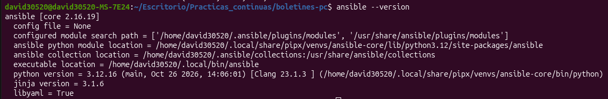

Para que la dependencia sea reproducible, se declaró en el repositorio en `deploy/requirements.yml`. Esta parte corresponde al commit [`763cc38`](https://github.com/david30520/boletines-pc/commit/763cc386f8b55211164977970a1488569d8e1ad1) (`chore: declara la collection community.docker para Ansible`, commit 1 de la tabla), de la rama `feat/despliegue-ansible` del PR [#24](https://github.com/david30520/boletines-pc/pull/24).

### Parte B

En lugar de usar servidores reales, la infraestructura se simula con tres contenedores Linux con SSH que hacen de máquinas destino: dos para la aplicación (`app1` y `app2`) y uno para la base de datos (`db1`). Se definieron en `deploy/servidores/docker-compose.yml`, cada uno con su puerto SSH publicado en un puerto distinto del anfitrión (`2223`, `2224` y `2225`).

Se levantó la flota con `docker compose -f deploy/servidores/docker-compose.yml up -d` y, antes de usar Ansible, se comprobó que los tres contenedores estaban en marcha y que se podía entrar por SSH en cada uno (`ssh root@localhost -p 2223`, `2224` y `2225`, con la contraseña `root`).

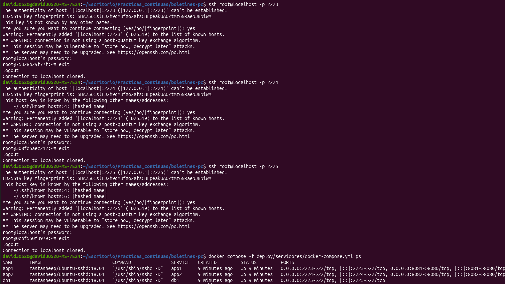

Esta parte corresponde al commit [`cc4b34f`](https://github.com/david30520/boletines-pc/commit/cc4b34ff991a2673bca6f949679959602c3b99a0) (`feat: añade la flota de servidores destino con Docker Compose`, commit 2 de la tabla), de la rama `feat/despliegue-ansible` del PR [#24](https://github.com/david30520/boletines-pc/pull/24).

### Parte C

Para que Ansible sepa a qué máquinas conectarse, se creó el inventario `deploy/inventory.ini`, que agrupa la flota por rol: `app` (`app1` y `app2`), `db` (`db1`) y `servidores`, que contiene a los dos anteriores. Como la conexión es por contraseña, se instaló `sshpass` para que Ansible pueda enviarla por SSH.

Después se comprobó la conexión con un ping de Ansible a toda la flota (`ansible -i deploy/inventory.ini servidores -m ping`), al que respondieron con `pong` las tres máquinas. A partir de este punto Ansible ya controla la flota.

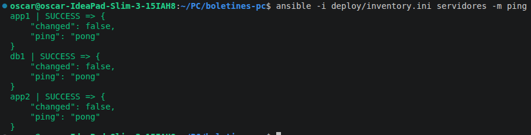

Esta parte corresponde al commit [`22ec55a`](https://github.com/david30520/boletines-pc/commit/22ec55aff6724bd617a0e95f302e30dcbfb27827) (`feat: añade el inventario de Ansible agrupado por rol`, commit 3 de la tabla), de la rama `feat/despliegue-ansible` del PR [#24](https://github.com/david30520/boletines-pc/pull/24).

### Parte D

Con la flota accesible desde Ansible, se escribió el playbook `deploy/deploy.yml`, que describe el estado deseado de cada grupo de máquinas. Primero prepara Docker en toda la flota; después despliega la base de datos PostgreSQL en el grupo `db` y, por último, la API en el grupo `app`, usando la imagen publicada en GHCR en el Boletín 5 (`ghcr.io/david30520/boletines-pc`).

La versión de la imagen se indica con la variable `version_app`, de forma que siempre se despliega un tag concreto y nunca `latest`. Así se sabe en todo momento qué versión está corriendo y se puede volver a una anterior. Los contenedores de la base de datos y de la API usan `network_mode: host`, porque cada máquina de la flota es a su vez un contenedor con su propio Docker dentro: compartiendo la red de la máquina que los aloja, la API puede llegar a `db1` por su nombre y su puerto queda expuesto directamente en la máquina. El play de la aplicación termina con un smoke test que espera a que `/actuator/health` responda `UP`.

Las credenciales (usuario y token de GHCR y datos de la base de datos) no se escriben en el playbook, sino que se leen de variables que se definen cifradas en la Parte E. Por eso en esta parte el playbook todavía no se ejecuta, y solo se comprobó que la sintaxis era correcta con `ansible-playbook -i deploy/inventory.ini deploy/deploy.yml --syntax-check`.

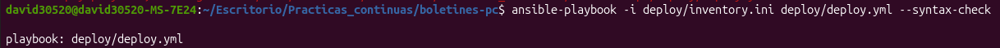

Esta parte corresponde al commit [`88b7d4a`](https://github.com/david30520/boletines-pc/commit/88b7d4ab1ae3ffa2e8a9f154c3beeaa721b158a0) (`feat: añade el playbook de despliegue con Ansible`, commit 4 de la tabla), de la rama `feat/despliegue-ansible` del PR [#24](https://github.com/david30520/boletines-pc/pull/24).

### Parte E

Las credenciales que usa el playbook no pueden escribirse en él ni pasarse con `--extra-vars`, porque quedarían en el repositorio o en el historial de la shell. Por eso se guardaron cifradas con Ansible Vault en `deploy/group_vars/servidores/vault.yml`: el usuario y un token de GHCR con solo el permiso `read:packages`, y el nombre, usuario y contraseña de la base de datos. El fichero se creó con `ansible-vault create`, que pide una contraseña maestra; esa contraseña no se guarda en el repositorio.

Se comprobó con `cat` que el fichero versionado es ilegible: solo contiene la cabecera `$ANSIBLE_VAULT;1.1;AES256` y el contenido cifrado.

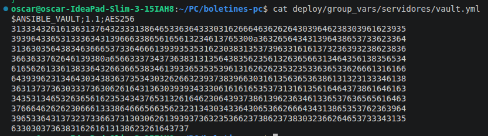

Esta parte corresponde al commit [`febafdb`](https://github.com/david30520/boletines-pc/commit/febafdbfd0ebad1cd12881a63794a9f8227c0c61) (`feat: añade las credenciales cifradas con Ansible Vault`, commit 5 de la tabla), de la rama `feat/despliegue-ansible` del PR [#24](https://github.com/david30520/boletines-pc/pull/24).

### Parte F

Con el playbook y las credenciales listos, se lanzó el primer despliegue contra toda la flota con la versión 1.0.0, la publicada en el Boletín 5:

```bash
ansible-playbook -i deploy/inventory.ini deploy/deploy.yml \
  --ask-vault-pass --extra-vars "version_app=1.0.0"
```

Ansible instaló Docker en las tres máquinas, levantó PostgreSQL en `db1` y la API en `app1` y `app2`, y el smoke test confirmó que las dos réplicas estaban sanas.

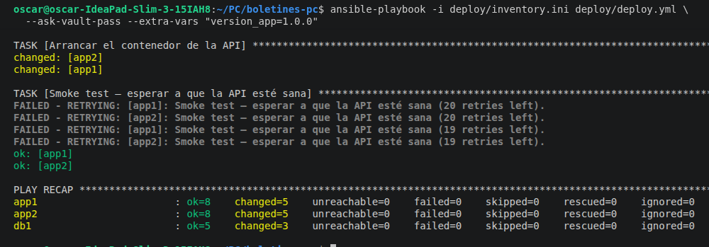

Para comprobar que las dos réplicas usan la misma base de datos, se creó una tarea con un `POST` a `app1` (`localhost:8081`) y se consultó con un `GET` a `app2` (`localhost:8082`), que la devolvió.

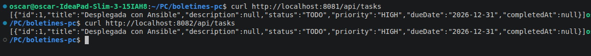

Después se volvió a lanzar el mismo playbook sin cambiar nada. Ansible informó de `changed=0` en las tres máquinas, porque todo estaba ya en el estado deseado: esta es la idempotencia.

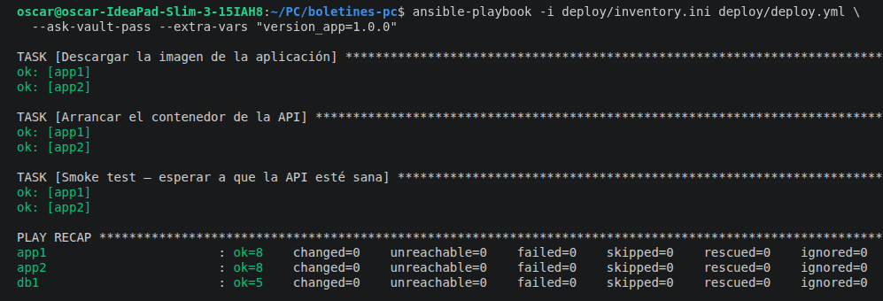

Para poder desplegar una versión nueva y distinguirla de la anterior, se añadió el goal `build-info` al plugin de Spring Boot, que hace que `/actuator/info` muestre la versión de la aplicación. Esto corresponde al commit [`a2268b8`](https://github.com/david30520/boletines-pc/commit/a2268b81043a2aad43ce7c6412f0164ac992df55) (`feat: expone la versión de la aplicación en /actuator/info`, commit 6 de la tabla). Después se subió la versión del `pom.xml` a 1.1.0 en el commit [`97f92ef`](https://github.com/david30520/boletines-pc/commit/97f92ef8938396af165132b69bdb5bb558fdf2bf) (`chore: sube la versión a 1.1.0 en el pom.xml`, commit 7 de la tabla), y sobre él se creó y subió la etiqueta `v1.1.0`. Ambos commits son de la rama `feat/despliegue-ansible` del PR [#24](https://github.com/david30520/boletines-pc/pull/24). La etiqueta disparó el workflow de release, que publicó la imagen con el tag `1.1.0` en GHCR.

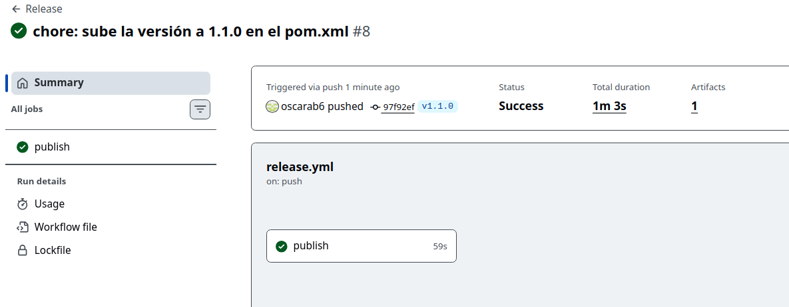

Se relanzó el playbook con `version_app=1.1.0`. Esta vez Ansible sí informó de cambios en `app1` y `app2`, donde descargó la imagen nueva y recreó el contenedor de la API, y ninguno en `db1`.

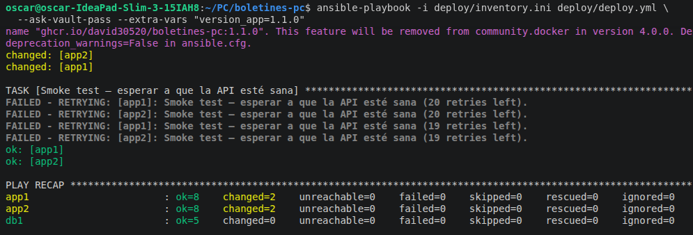

Las dos réplicas pasaron a mostrar la versión 1.1.0 en `/actuator/info`, y la tarea creada antes seguía disponible, porque la base de datos no se había tocado.

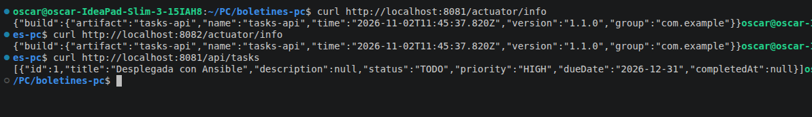

Por último, se hizo rollback relanzando el playbook con `version_app=1.0.0`. Como la imagen 1.0.0 ya estaba descargada en las máquinas, la vuelta atrás en las dos réplicas tardó menos de un minuto (unos 34 segundos según `time`), y `/actuator/info` volvió a responder vacío, como corresponde a la 1.0.0, que no incluye la información de build. Esto solo es posible porque se despliega por tags inmutables y no por `latest`.

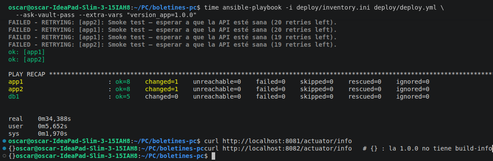

### Parte G

Para cerrar el ciclo de despliegue continuo, el despliegue se automatizó desde GitHub Actions. Como las máquinas de la flota son contenedores que solo existen en un ordenador local, un runner de GitHub en la nube no podría llegar a ellas, así que se registró ese ordenador como runner autoalojado (**Settings → Actions → Runners**). El runner quedó en marcha con `./run.sh` y en estado **Idle**, en una máquina con Ansible, `sshpass` y la flota levantada.

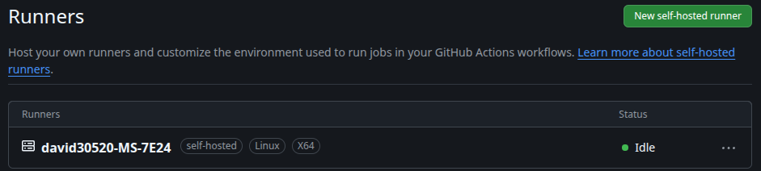

Después se creó el entorno `produccion` con un reviewer obligatorio, para que ningún despliegue arranque sin aprobación manual, y se guardó en él el secret `VAULT_PASS` con la contraseña maestra del Vault.

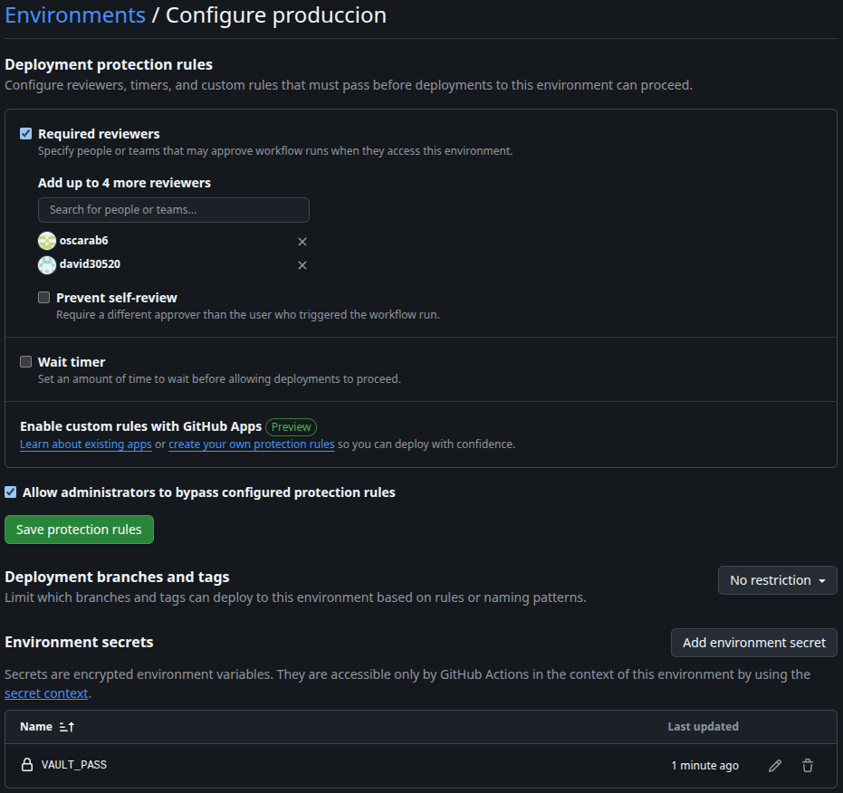

Se amplió el workflow `release.yml` con el job `deploy`, que solo se ejecuta con etiquetas `vX.Y.Z`, después de que `publish` haya publicado la imagen, y que lanza el playbook en el runner autoalojado con la versión publicada. Esto corresponde al commit [`8ff5b60`](https://github.com/david30520/boletines-pc/commit/8ff5b607587876c97fb33b00288117764c24d3b1) (`ci: añade el job deploy con Ansible al workflow de release`, commit 8 de la tabla).

Para probarlo de extremo a extremo, se subió la versión del `pom.xml` a 1.2.0 en el commit [`b68cd84`](https://github.com/david30520/boletines-pc/commit/b68cd846a102aa12ee9d36f4a098c11c16b0cda3) (`chore: sube la versión a 1.2.0 en el pom.xml`, commit 9 de la tabla) y se creó y subió la etiqueta `v1.2.0`. En la pestaña Actions, el job `publish` se ejecutó en GitHub y el job `deploy` quedó en pausa esperando la aprobación del entorno `produccion`.

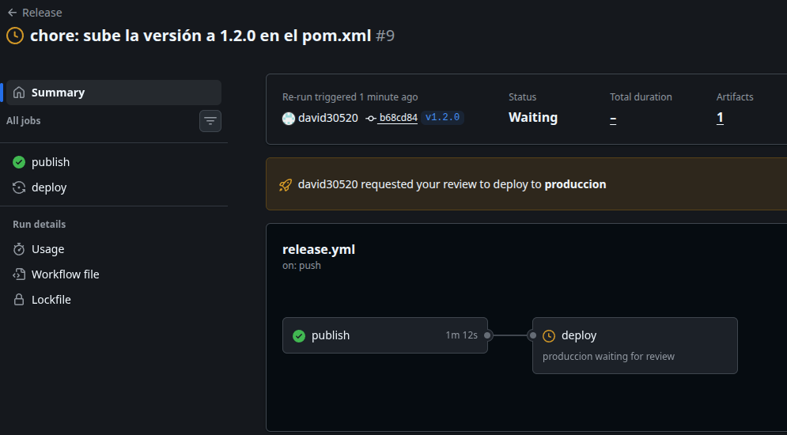

Tras aprobarlo, el runner autoalojado recibió el trabajo y ejecutó el playbook.

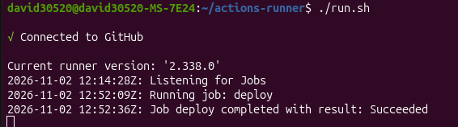

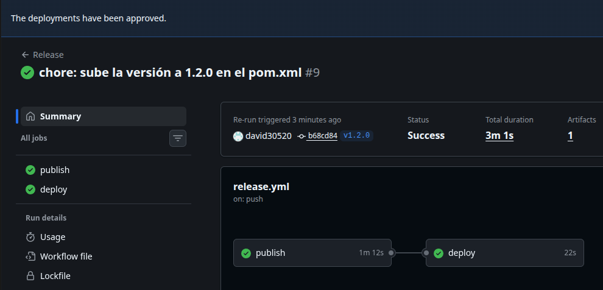

Las dos réplicas pasaron a responder con la versión 1.2.0 en `/actuator/info`, sin ninguna intervención manual más allá de la aprobación.

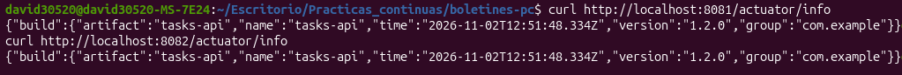

Por último, se documentó la arquitectura completa en el `README.md` con un diagrama que muestra dónde se ejecuta cada pieza (GitHub, el ordenador anfitrión y los contenedores `app1`, `app2` y `db1` con su propio Docker), los puertos expuestos, las conexiones entre piezas con su protocolo y quién las inicia, y los pasos numerados desde el `git push` de la etiqueta hasta que la aplicación queda corriendo en las dos réplicas. Esto corresponde al commit [`7767313`](https://github.com/david30520/boletines-pc/commit/77673130c83af570e280461d395aab5bbfa3f10a) (`docs: añade al README el despliegue con Ansible y su arquitectura`, commit 10 de la tabla).

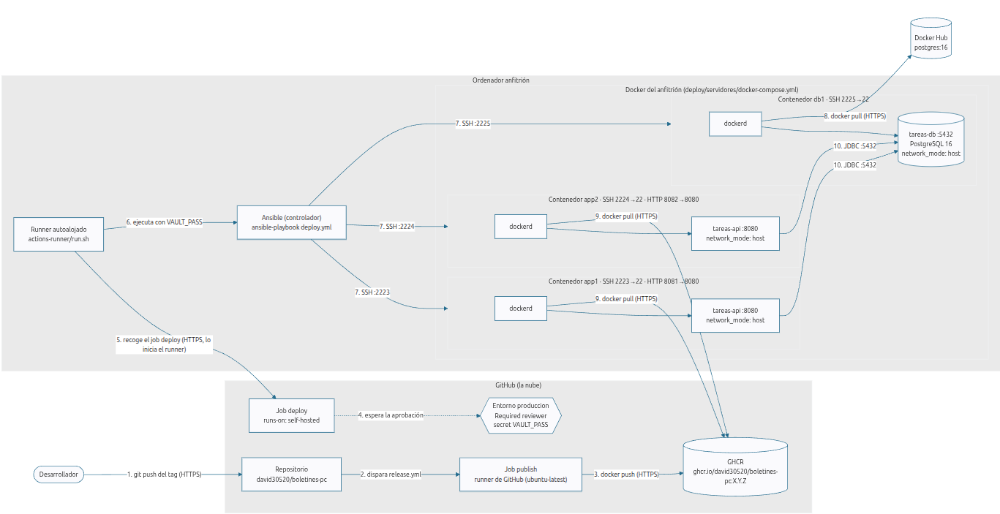

Los commits 8 a 10 son de la rama `feat/despliegue-ansible`. Con todo el trabajo terminado, se abrió el PR [#24](https://github.com/david30520/boletines-pc/pull/24) de esa rama a `main`, que se fusionó con squash en el commit [`ea6e0d8`](https://github.com/david30520/boletines-pc/commit/ea6e0d8a528d911f5bb072daba854d1ea005b282) (`Feat/despliegue ansible (#24)`, commit 11 de la tabla).